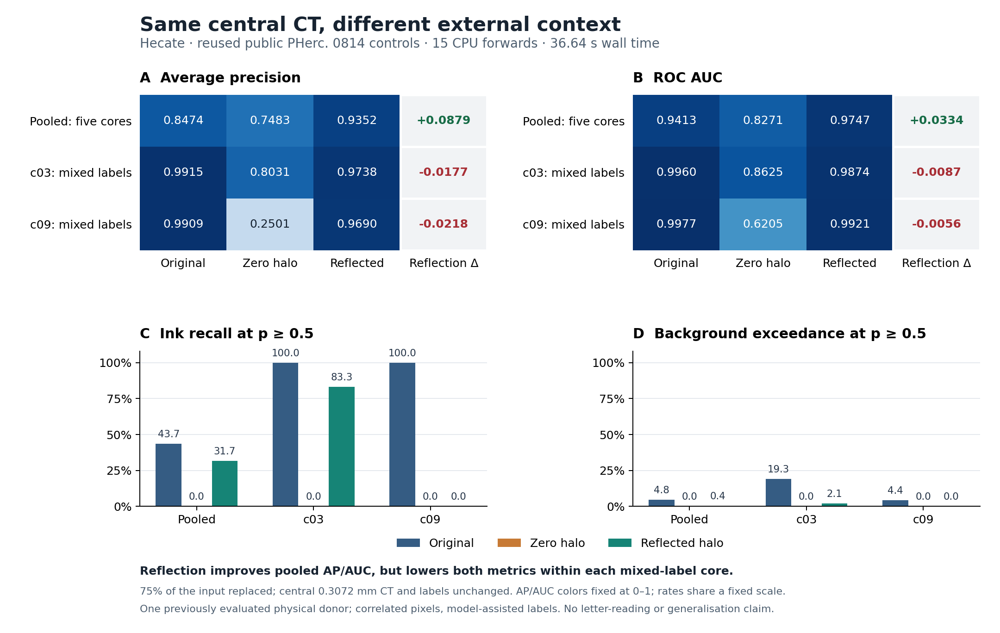

# Actual Hecate response to missing external context

This is a bounded **real-model CPU experiment** on previously acquired public
PHerc. 0814 controls. It turns one question from the producer-support work into
an intervention: can changing only the outside of an input patch change the
predicted ink in its bitwise-unchanged center?

The protocol and runner must be committed publicly before new model forwards.
The runner checks their exact committed bytes using `--freeze-reference`; a
protocol file written immediately before inference is not the public freeze.
At preparation time no result is claimed. A completed `result.json` is the
record of a real run.

## Measured results

**From a source — measured:** the [completed receipt](evidence/result.json)
records **15 real CPU forwards in 36.64 seconds wall time**, including
31.18 seconds of inference, after the
[public protocol freeze](https://github.com/JorisViaudQuantAI/Scrollprize/commit/0540b2ee4b9e60d4c10381265f16b13dd1561c8c).
All five original predictions exactly reproduced the previously cached
baselines. The [independent review](evidence/independent_review.json) passed:
it verified the unchanged central values and scoring masks and recomputed
metrics with maximum absolute scalar error 2.22 × 10⁻¹⁶. The review required
no further model forwards.

| Condition | Pooled AP | Pooled AUC | Ink recall at p ≥ 0.5 | Background exceedance at p ≥ 0.5 |
| --- | ---: | ---: | ---: | ---: |
| Original | 0.8474 | 0.9413 | 43.69% (679/1,554) | 4.80% (171/3,566) |
| Zero halo | 0.7483 | 0.8271 | 0% (0/1,554) | 0% (0/3,566) |
| Reflected halo | 0.9352 | 0.9747 | 31.66% (492/1,554) | 0.42% (15/3,566) |

**From a source — measured:** reflection increases pooled AP and AUC, but
**reduces both metrics in each of the two mixed-label contexts**. In c03, AP
falls from 0.9915 to 0.9738 and AUC from 0.9960 to 0.9874. In c09, AP falls
from 0.9909 to 0.9690 and AUC from 0.9977 to 0.9921; its thresholded ink
recall falls from **207/207 to 0/207**, despite identical central CT. Zero
padding eliminates every positive call at the fixed threshold. The exact
per-context results, including all three pure-class contexts, remain in the
[receipt](evidence/result.json).



**My inference:** pooled ranking gains alone do not establish better local
ink recovery. They can coexist with worse ranking within every mixed-label
patch because the ordering of scores between patches also changes. This
experiment demonstrates sensitivity to external context; it does not validate
reflection as an ink-detection improvement. The intervention replaces **75%
of the input**, so it is a severe stress test, not a measurement of typical
missing-data effects. Five previously evaluated sub-letter cores from one
public donor, correlated model-assisted labels, favorable depth-order reuse,
and unresolved training exposure cannot establish new-scroll generalisation
or letter legibility.

**From the [executed runner](run.py):** Hecate's nonzero-column input mask is recomputed
from each altered array. Its central values remain identical, but its halo can
change along with the CT. This is a joint CT-and-validity-context intervention;
it does not isolate an intensity-only effect or validate that legacy mask as an
acquisition-support certificate. The result measures this Hecate checkpoint,
not the magnitude of the effect in Studio or another model family.

The figure uses aggregate JSON only; no CT, prediction images, or review
arrays are published here. Regenerate it without loading a model:

```bash
python firstletters-colab/context_intervention/plot_results.py
```

## Fixed inputs and scope

**From the prior measured source:**
[`hecate_role_result.json`](../transversal_lab/evidence/hecate_role_result.json)
contains five PHerc. 0814 contexts with known central labels among sixteen
previously evaluated contexts. This experiment keeps all five: c00, c03, c08,
c09 and c12. Their 5,120 known pixels contain 1,554 ink labels and 3,566
background labels. c03 and c09 contain both classes; c00/c12 are background
only and c08 is ink only. Pure-class AP/AUC remain undefined here.

**Method decision:** reuse the previously favorable reversed depth order. The
selection and orientation are explicitly conditional on prior results. This
is a development stress test, not a new held-out accuracy benchmark. The
labels are model-assisted, and the released checkpoint's inherited donor
exposure remains unresolved.

**From the source contract:** the existing
[donor manifest](../transversal_lab/hecate_donor_manifest.json) and
[sampling protocol](../transversal_lab/hecate_probe_protocol.json) describe
released high-resolution surface slabs, box-averaged to 9.6 µm, rounded once
to uint8 and divided by 255 once. These are **not native coarse-acquisition
CT samples**. The experiment reuses the pinned extraction and exact 40/39
categorical-grid mapping. All source bytes must already exist in the cached
prior acquisition, with their original receipt hashes. There is no network
fallback, missing-chunk fill, retraining, or new source acquisition.

The released model source and weights are pinned to the same
[Hecate release](https://huggingface.co/scrollprize/hecate/blob/9cb86e500e944b11a06a7020403cde5dffb5bcb2/hecate.py)
as the previous run. The official forward receives the same nonzero-column
mask repeated over all sixteen planes as the prior cached projection. The
central prediction support stays unchanged under both interventions.

## Three fixed conditions

For each `[16,64,64]` model input:

| Condition | Central XY `[16:48,16:48]` | Remaining input halo |
| --- | --- | --- |
| original | Original CT, all sixteen planes | Original CT |
| zero_halo | Exactly the same CT | Zero-filled |
| reflect_halo | Exactly the same CT | NumPy `reflect` padding from the center |

The halo comprises **75% of the input XY area**, or 49,152 of 65,536 input
voxels. This is severe context ablation. It does not model the prevalence or
typical size of missing chunks. The central 32 pixels span only **0.3072 mm**;
the experiment cannot establish letter or line legibility.

Both artificial conditions have zero conservative full-real-context support.
This does not mean their central CT is unavailable: its pixels and labels
remain unchanged and are still scored deliberately to measure the effect of
the missing surrounding context. Reflected values cannot be relabelled real
source support, even if their intensities look reasonable.

## Execution and endpoints

There are exactly **15 model forwards**, CPU float32, batch one, four Torch
threads, inference/eval mode. Each unchanged-condition forward must reproduce
its old reverse-order cached logits within **maximum absolute difference
1e-5** before running that context's altered conditions. A mismatch stops the
experiment with a partial receipt; no threshold is adjusted afterward.

The wall-time cap is **600 seconds**, including source rereading and loading.
The inference stage arms a Unix alarm for the remaining allowance; an
in-flight native operation can defer Python signal handling until it returns.
There is no automatic retry, partial-result promotion, or context replacement.

Results retain every context and every condition:

- Exact central CT and label hashes and the unchanged input check.
- Known-label AP/AUC when both classes exist, plus pooled descriptive values.
- Recall and labelled-background exceedance at `sigmoid(logit) >= 0.5`.
- Paired probability signed/absolute changes, fixed quantiles, correlation
  when defined, and disagreement at the same threshold.
- Per-forward time, total time, peak RSS, model-buffer invariance, source,
  model, protocol and output hashes.

Pooled results can change through cross-context score calibration; retain the
within-context mixed-class results. Correlated pixels from one physical
surface are not independent scroll replicates. No threshold here estimates
an unread-scroll false-positive rate.

## Run locally after the public freeze

The following arguments point to the already retained task caches. Replace
`FREEZE_COMMIT` with the published full commit containing this runner and
protocol. This command does not download anything.

```bash
python firstletters-colab/context_intervention/run.py \
  --freeze-reference FREEZE_COMMIT \
  --cache /tmp/vesuvius-hecate-probe-role-v1/source-cache \
  --prior-run /tmp/vesuvius-hecate-probe-role-v1 \
  --checkpoint /tmp/vesuvius-hecate-probe-preflight/hecate_9.6um.pth \
  --hecate-source /tmp/vesuvius-transversal-sources/hecate.py \
  --output-dir /tmp/scrollprize-context-intervention-v1
```

Use the Python environment with the pinned Hecate dependencies, including
Torch, NumPy, SciPy, Pillow, numcodecs and the source model's dependencies.
No GPU is required. The output directory must be new and outside every Git
worktree. Inputs and logits are retained there for each forward, with a
`progress.json` after every forward and a `failure.json` if execution fails.
A completed `review_arrays.npz` contains the five central CT means, labels,
support, condition logits/probabilities, IDs and condition ordering for
independent scoring and fixed-scale plotting without another model call.

## Generated-array verification

```bash
python -m unittest discover -s firstletters-colab/context_intervention -p 'test_*.py' -v
```

These seven tests check unchanged centers and exact reflection geometry,
nonmutation of inputs, dtype/shape rejection, logit-to-probability thresholds,
unknown and pure-class labels, tie-aware AP/AUC, paired-change direction, and
the cache's refusal to download unknown or absent data. They do not run a
model or replace the real experiment.
