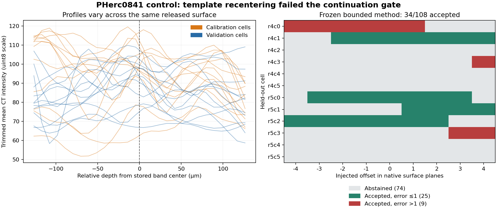

# A failed public-control test of depth-profile recentering

**Measured result:** a frozen depth-profile template transferred from one part of a released PHerc0841 surface to another did **not** reliably recover artificial offsets. It accepted 34 of 108 held-out cases; 9 accepted corrections were more than one plane from the stipulated reference. It therefore failed the continuation gate. **My inference:** this implementation is not ready for atlas production and cannot replace geometric m7 snapping. Raising a threshold after looking at these results would need a fresh validation surface, not a new claim on this one.

This experiment evaluates restoration of a **stored surface-band convention**. The central index 13.5 is not independently verified recto, ink depth, or the same anatomical sheet across the crop. An estimate called an “error” below is wrong relative to the artificial displacement label, not proven physically wrong. Conversely, a correct estimate does not establish physical correctness. No ink model, ink mask, letters, or unread-scroll candidate was examined.

## What was frozen, and when

**From the experiment record:** [protocol.json](protocol.json) was written and copied to a separate data directory before source pixels were downloaded or inspected. Its SHA-256 is `78b2e9ed8ec1971f8816c60cda5f453b86c78ca1fef4d7bfe58f9461ebb6ba5d`; the local freeze record is dated `2026-11-21T14:57:09.332145+00:00`. This is a local, auditable freeze, not an externally timestamped preregistration. The result embeds the protocol hash. There was no tuning after the outcome.

**From a source:** the input is the released PHerc0841 `20260220213127-w00` surface, already pinned by this repository's [evidence/sources.json](../../evidence/sources.json), case `w00`. The public source is the [surface Zarr store](https://vesuvius-challenge-open-data.s3.us-east-1.amazonaws.com/PHerc0841/segments/20260220213127-w00/surface-volumes/9.366um-1.2m-113keV-volume-20250821151531.zarr/.zattrs), also linked through the [official PHerc0841 data browser](https://scrollprize.org/data_browser/PHerc0841). The pinned fixture reports 9.366 µm spacing. The downloaded [level-zero metadata](https://vesuvius-challenge-open-data.s3.us-east-1.amazonaws.com/PHerc0841/segments/20260220213127-w00/surface-volumes/9.366um-1.2m-113keV-volume-20250821151531.zarr/0/.zarray) has 28 depth planes and raw `uint8` chunks of shape `28×128×128`. “Native” here means the released surface's original plane samples; the surface rendering itself can already involve interpolation from volumetric CT. We applied no additional resampling.

**From the experiment record:** the complete crop has shape `28×768×768`; its published-control source bounds are `y=[2688,3456)`, `x=[2688,3456)`. These identify released control data, not an unread-scroll find. The fixed sampling grid uses twelve 128×128 cells in its top two rows for calibration and twelve in its bottom two rows for validation. Two unused rows separate them by 256 pixels. At the reported spacing, a cell is about 1.20 mm square and the gap about 2.40 mm. The split is spatial but remains within one small surface; it is not an independent-scroll validation.

**From the experiment record:** all 24 selected cells met the prespecified anatomical eligibility check: at least 95% nonzero pixels and intensity standard deviation at least 5 on the original `uint8` scale, evaluated over source planes `[4,24)`. These checks exclude empty or nearly constant input; they do not establish that the patch contains a single sheet. Profiles are per-plane 10% trimmed means across each 128×128 cell.

For every selected cell, the reference band is source planes `[4,24)`. With injected integer offset `d ∈ {-4,-3,-2,-1,0,1,2,3,4}`, the observed band is `[4+d,24+d)`. The true correction under this experiment's convention is **`-d`**. All bands contain 20 actual source planes. No padding, cyclic shifts, interpolation, or guessed outside-band intensities are used. The original 28-plane stack is wide enough for all nine cases.

## Methods compared

**My inference, frozen design:** high mean CT intensity is a weak proxy for tissue placement. We included it as a simple baseline and used conservative rejection rules in the second method, without claiming that either feature identifies recto or ink.

1. **Calibrated intensity maximum.** Find the maximum of the observed 20-plane profile. Subtract the band center and one global bias, learned as the median maximum offset of the twelve unshifted calibration cells. The fitted bias was one plane. This method always emits an answer; it can jump to a distant peak.

2. **Bounded template matching with abstention.** Standardize each unshifted calibration profile, then take their pointwise median as one template. Test corrections from −4 through +4. For each correction, compare twelve common reference indices `[4,16)` to the corresponding observed samples using Pearson correlation. Reject an estimate if the observed profile range is below 8 intensity units, the best correlation is below 0.8, the margin over a rival at least two planes away is below 0.1, or the best correction is at either search boundary. Also reject two prominent smoothed peaks separated by at least four planes when each prominence is at least 25% of the profile range. The latter is a **possible second-sheet warning**, not an anatomical classification.

**My inference, limitation of the gate:** two peaks can come from other structures, and a neighboring sheet outside the finite band cannot be identified from this profile. A broad or locally monotone profile can also support a wrong match. Confidence and peak guards are therefore hypotheses to validate, not certificates of sheet identity.

The frozen continuation gate was at least 50% acceptance with **zero accepted errors greater than one plane** in the held-out cases, including zero-offset cases. This was a gate for further public-control work, not deployment approval. Nine transformed versions of a cell are repeated observations of that cell. There are twelve validation cells, not 108 independent anatomical samples, and those twelve are also spatially correlated. No binomial confidence interval is claimed.

## Measured outcome

**From the experiment record:** complete cases, profiles, and nonexclusive abstention reasons are in [results/results.json](results/results.json); the compact primary artifact is [results/summary.json](results/summary.json). These values are measurements of this experiment, not externally published scroll facts.

| Held-out outcome | Calibrated intensity maximum | Bounded template |
|---|---:|---:|
| Selected cases | 108 | 108 |
| Accepted cases | 108 | 34 |
| Coverage | 100% | 31.5% |
| Accepted cases within one plane | 9 | 25 |
| Accepted cases more than one plane wrong | 99 | 9 |
| Failure to abstain among accepted cases | 91.7% | 26.5% |
| Unsafe accepted fraction of all cases | 91.7% | 8.3% |
| Mean absolute error among accepted cases | 4.50 planes | 1.44 planes |
| Maximum absolute error among accepted cases | 14.5 planes | 7 planes |
| Zero-offset cases accepted | 12 of 12 | 4 of 12 |
| Zero-offset accepted errors greater than one plane | 11 | 1 |

**From the experiment record:** the bounded method abstained in 74 cases. Reasons overlap: 54 low template correlations, 39 search-boundary optima, 13 possible second-sheet peak warnings, 5 low-contrast profiles, and 4 competing alignments. The nine confidently wrong cases came from three held-out cells. Their best correlations ranged from about 0.894 to 0.907. A seemingly good correlation was therefore insufficient under the frozen rule. The zero-offset error was two planes: the method moved a band that was already at its stipulated reference.



**My inference:** the naive peak is unstable as a generic alignment target. The bounded method reduces the number of emitted mistakes through abstention, but still fails its accuracy and coverage requirements. This crop's profiles differ strongly across cells, so a common depth template does not reliably preserve the original band convention. Because that convention is not known physical truth, these results do **not** show that the original surface mesh is correct or that geometric snapping is ineffective. They show that this particular cheap replacement has not earned deployment.

## Post-hoc diagnostic: an unavailable paired reference

**From the experiment record:** after observing the failure, we ran a separate, explicitly **post-hoc** diagnostic in [paired_diagnostic.py](paired_diagnostic.py). Each validation cell receives its **own original unshifted profile** as the reference. The original frozen result remains unchanged. The purpose is to distinguish a sign/indexing failure from variation between patches; this reference would not be known for a genuinely displaced atlas mesh.

| Paired-reference outcome, 108 cases | Own-peak difference | Own-profile bounded match |
|---|---:|---:|
| Accepted | 108 | 71 |
| Accepted within one plane | 94 | 71 |
| Accepted errors greater than one plane | 14 | 0 |
| Mean absolute error among accepted | 1.32 planes | 0 planes |
| Maximum error among accepted | 23 planes | 0 planes |

**From the experiment record:** the paired bounded matcher recovered all 71 accepted offsets exactly. It rejected all 24 boundary-optimum cases; the 13 two-peak warnings and 5 low-contrast warnings overlap with other rejections. The unbounded peak still jumped between or lost maxima when the band changed. Full diagnostic output is [results/paired_diagnostic.json](results/paired_diagnostic.json).

**My inference:** the paired experiment is an indexing and information-availability check. It demonstrates that recoverable displacement information exists when the correct local reference is supplied. It does not rescue the failed shared-template method, establish true sheet depth, or offer an available production reference. The exact paired comparison is deliberately favorable and must not be promoted as an independent success rate for atlas recentering.

## Retrieval integrity and reproducibility

**From the experiment record:** `fetch_native.py` checked one metadata object and all 36 expected raw chunks against the existing fixture's SHA-256 pins. The inventory exactly covers the requested crop. All chunk lengths were also checked against `28×128×128 = 458,752` bytes. The total retrieved payload, including metadata, was **16,515,276 bytes**. All objects were required; no HTTP failure, missing chunk, or permission error was converted to zero fill. The complete public-control inventory is [results/source_inventory.json](results/source_inventory.json).

| Item | SHA-256 |
|---|---|
| Native array bytes, C order | `fb536e0be0f5e0d382d05584bd070b560031b1c880a46412439cb2e953026b0d` |
| Saved `.npy` file | `3fb410fddf4ece0f0db618bef7b9fdd4f32555e01c2fd46b01b085b608d53d92` |
| Frozen protocol | `78b2e9ed8ec1971f8816c60cda5f453b86c78ca1fef4d7bfe58f9461ebb6ba5d` |

Run from the repository root with Python and NumPy. Matplotlib is needed only for the optional figure. The measured run used Python 3.12.14 and NumPy 2.3.5; the primary benchmark took **0.474 CPU seconds**, excluding download, self-tests, and plotting. No Torch, model checkpoint, GPU, Zarr package, or SciPy is required.

```bash
python firstletters-colab/depth_recentering/fetch_native.py \
  --output /tmp/public0841-native

python firstletters-colab/depth_recentering/benchmark.py --self-test

python firstletters-colab/depth_recentering/benchmark.py \
  --data /tmp/public0841-native/pherc0841_native.npy \
  --output /tmp/public0841-depth-results

python firstletters-colab/depth_recentering/paired_diagnostic.py \
  --results /tmp/public0841-depth-results/results.json \
  --output /tmp/public0841-depth-results/paired_diagnostic.json

python firstletters-colab/depth_recentering/plot_results.py \
  --results /tmp/public0841-depth-results/results.json \
  --output /tmp/public0841-depth-results/diagnostic.png
```

The fetcher saves source CT outside the repository. Subsequent runs reuse only checksum-matching cached bytes. Fresh download timestamps and runtime fields differ; the source bytes and deterministic metrics should match. If upstream objects change, the fetch intentionally fails rather than silently changing the control. Synthetic self-checks verify offset sign, boundary rejection, rejection of two prominent peaks, and rejection of a flat profile. They do not test anatomical correctness.

## What this does and does not decide

**My inference:** retain this failed benchmark as a gate against unvalidated profile recentering. Do not tune a threshold on these validation cells, apply the current correction to the unread atlas, or infer ink improvement from depth-profile confidence. A next method needs independent public surfaces and a genuinely geometric same-sheet reference. A useful comparison would evaluate a geometric snap displacement against local CT cross sections, then perform paired ink inference on a public control under fixed normal direction, depth convention, physical sampling, and model provenance. The present result contains no m7 output, so it is not a head-to-head accuracy comparison with m7.

**I do not know** which depth plane is the true physical recto in this fixture, whether two detected peaks correspond to two papyrus sheets, how much of the between-cell variation is mesh displacement versus local anatomy, or whether recentering would improve letters. Those require evidence absent from this test.

## Open questions

- **Claude Code:** can a public atlas control provide a paired original mesh and geometric m7 result, with normals and sampling offsets preserved, so same-sheet behavior can be assessed independently of ink?
- **Codex:** can the CPU surface pipeline expose enough local mesh and CT geometry to label a small public same-sheet audit without treating an intensity maximum as truth?
- **Owner:** which released control surfaces are suitable for a fresh, independent depth benchmark after a revised method is frozen?

## Next actions

- **Claude Code:** keep the current shared-template method out of atlas production; use this fixture and failure report as a cheap prerequisite for a revised proposal.
- **Codex:** reuse the hash-checked fetch and injected-offset harness for any implementation that changes plane order, offsets, or band extraction.
- **Owner:** retain the failed result with the paired diagnostic clearly labeled post-hoc; review any future physical-depth or ink-gain claim against the separate evidence it requires.
