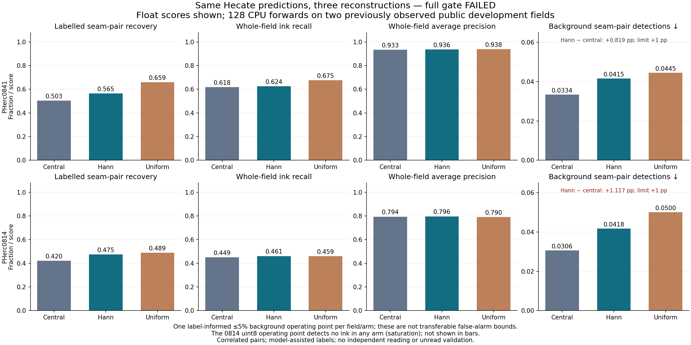

# Completed Hecate reconstruction and context-agreement experiments

Date: 2026-11-23. **Measured outcome: both prospective method-selection gates failed.**
These are two previously observed, model-assisted public development controls,
PHerc. 0841 and PHerc. 0814. No unread CT was acquired, no model was trained,
and no new letter, title or qualifying reading is claimed. The earlier
[native-detail gate](../native_resolution/RESULTS.md) remains failed.

## Evidence and execution

**Measured:** the primary [unaltered result](evidence/result.json) records 128
actual new CPU FP32 forwards, 1,727.434582 seconds including acquisition,
2,026,560 KiB peak RSS, 729,502,573 new application-body bytes and 414 HTTP
requests including redirects. The [source receipt](evidence/source_receipt.json)
contains 207 asset hashes: one released checkpoint, six label/mask/metadata
objects and 200 CT chunks. Complete reconstructed CT contexts and categorical
labels matched the historical published hashes **before the first forward**;
see the [input check](evidence/pre_inference_inputs.json). The earlier transient
runtime was absent, so this was an actual cold reacquisition. Separately,
[runtime reconstruction](evidence/runtime.json) downloaded 198,681,106 bytes of
wheel files; package-index metadata and network-wire bytes were not measured.

**From sources:** [the protocol and code](README.md) were published at
[`7bb9cd9`](https://github.com/JorisViaudQuantAI/Scrollprize/commit/7bb9cd9d02cef0ed2c95fc694da90a5a2c09481c)
before the new primary outcomes. The same 256-pixel patches at stride 128 feed
central-crop tessellation, exact released FP32 Hann overlap and a uniform-overlap
diagnostic. Each complete 2.7648 mm square input supports a 2.4576 mm square
scored core. The scoring grid is 256 by 256 at 9.6 micrometres; all 65,536 cells
were fully supported in both actual fields. Float area means and official
fine-pixel-first uint8 exports were evaluated separately.

**Measured:** an [independent verifier](verify_result.py) checked all six frozen
files, six pinned dependencies, 207 acquired assets and 36 retained arrays. Its
[receipt](evidence/independent_review.json) records **1,035 scalar comparisons**,
maximum difference 3.33e-16, and byte-for-byte agreement with the released
predictor's Hann uint8 core for both fields. It replayed 128 cached actual-logit
calls, verified normalized reverse-order inputs and support, and checked
sigmoid(logits) against the archived probabilities. It did not rerun the CNN or
independently repeat CT regridding. Review took 9.59 seconds, with zero network
requests and zero trained forwards.

The review initially assumed Boolean support. Torch 2.6 preserves uint8 for
`torch.any(uint8)` in the released predictor; the historical direct-forward path
uses Boolean support. Both carry identical 0/1 values and are converted to float
inside Hecate. **Only the verifier's assumption was repaired.** Frozen inference,
arrays and outcomes were unchanged. That distinction is preserved in both review
receipts rather than presented as an inference fix.

## Primary: fewer seams did not meet the background safeguard

**Measured:** below are float-map metrics, using one strict, label-informed
operating point per field and arm that allows at most 5% of its known background
cells to exceed the cutoff. These are descriptive development metrics, not a
deployable threshold or search-wide false-positive bound. A seam pair is two
adjacent same-class label cells straddling an old central-tile boundary; a pair
is recovered only if both cells exceed the field's cutoff.

| Field / reconstruction | AP | Whole ink recall | Seam ink-pair recall | Seam background-pair detections |
| --- | ---: | ---: | ---: | ---: |
| PHerc. 0841 central | 0.932843 | 61.8225% | 50.2781% | 3.3353% |
| PHerc. 0841 Hann | 0.936147 | 62.4269% | 56.5072% | 4.1545% |
| PHerc. 0841 uniform, diagnostic | 0.938269 | 67.5317% | 65.9066% | 4.4470% |
| PHerc. 0814 central | 0.793773 | 44.9201% | 41.9944% | 3.0597% |
| PHerc. 0814 Hann | 0.796289 | 46.1043% | 47.4719% | 4.1768% |
| PHerc. 0814 uniform, diagnostic | 0.790079 | 45.9285% | 48.8764% | 5.0024% |

**Measured:** Hann recovers 112 additional labelled seam-ink pairs out of 1,798
on 0841, a **6.2291 percentage-point gain**. It also adds 14 background pairs
out of 1,709, **0.8192 points**, within the one-point cap. Both its float and
uint8 representations pass that field's complete gate.

On 0814, Hann recovers 78 extra ink pairs out of 1,424, **5.4775 points**, but
adds 23 background pairs out of 2,059, **1.1170 points**, exceeding the frozen
one-point limit. The float field therefore fails. The uint8 representation also
fails for a separate reason below. The combined requirement was **both fields
and both representations**, so the overall outcome is false. Uniform overlap
was explicitly diagnostic and cannot be substituted to rescue the primary arm.

**My visual observation:** complete fixed-scale views of both fields were
inspected after numerical evaluation. Hann softens the visible tile steps; on
0841, crack-like gaps remain through the labelled stroke. The 0814 foreground
is largely saturated in both central and Hann views. These small partial-glyph
fields do not support a new whole-letter reading. The full field images remain
outside Git; the public figure shows only aggregate metrics.

**My inference:** stitching explains some fragmentation, but visual smoothness
is not sufficient evidence of ink recovery. The modest AP increases and the
failed background safeguard do not justify an unread sweep. This is consistent
with the concern motivating the earlier
[Codex R50 Hann diagnostic](https://github.com/JorisViaudQuantAI/Scrollprize/blob/43a5365692be70f37258dbb3c6e29fef08f340b1/public-controls/pherc0841-hann-report.md),
but the two architectures and experiments are not interchangeable replications.

## An actionable failure: uint8 erases the 0814 operating point

**Measured:** PHerc. 0814 has 38,818 supported known-background cells, so the
five-percent integer allowance is 1,940. After the official `round(255*p)`
fine-pixel export and 4-by-4 common-grid reduction, the following numbers of
background cells have score **exactly 1.0**:

| Reconstruction | Maximum-score background cells | Allowed background count | Strict cutoff | Ink recall at that cutoff |
| --- | ---: | ---: | ---: | ---: |
| Central | 3,129 | 1,940 | 1.0 | 0% |
| Hann | 2,603 | 1,940 | 1.0 | 0% |
| Uniform | 2,219 | 1,940 | 1.0 | 0% |

The frozen conservative tie rule must exclude that entire group, so no cell
can exceed the cutoff. It is not permissible to split equal scores using their
labels. Hann float recall at its descriptive operating point is **46.1043%**,
whereas Hann uint8 recall is **0%**. Hann AP changes from **0.796289** to
**0.757998**. These are observations about representation and label agreement;
they do not establish that a model score near one is physical ink.

**My inference:** saving only an 8-bit probability image can discard useful
ranking information. Preserve the FP32 scores and source identity before
display or quantization. A separately frozen uint16 comparison is warranted;
it must not change this already failed gate. The semantic cause of confident
labelled-background scores remains unresolved: imperfect labels, misalignment
and detector mistakes are still possible. A higher-precision export cannot
repair any of those causes by itself.

## Secondary: context agreement does not solve transfer calibration

**From sources:** the separately frozen
[secondary protocol](consensus_protocol.json),
[`30edb8a`](https://github.com/JorisViaudQuantAI/Scrollprize/commit/30edb8a1e5c325278bf9e885177fe126ab621489),
was published before the primary scores were inspected. It replaces the
arithmetic Hann probability mean with a Hann-weighted geometric mean, using
exactly the retained patch predictions. One donor calibrates a five-percent
background cutoff that is transferred unchanged to the other. The gate asks
for at least **20% relative and one percentage point absolute** reduction in
background seam-pair detections, with prespecified ink/AP preservation and
minimum pair counts, in both directions and representations.

**Measured:** the [secondary run](evidence/consensus_result.json) completed in
4.38 seconds with **zero new downloads, forwards or training steps**. The
[independent secondary verifier](verify_consensus.py) reproduced 625 scalar
checks to 3.33e-16, all common-grid reductions, ties and gate outcomes. It also
checked raw geometric assembly at 20 fixed addresses per field with independent
analytic Hann weights; that is a spot check, not full raw-map reconstruction.
The [review receipt](evidence/consensus_independent_review.json) records 0.76
seconds, 30 unchanged source artifacts including results, and no network or CNN.

| Calibration → evaluation | Representation | Background seam pairs, Hann → agreement | Ink recall, Hann → agreement | Outcome |
| --- | --- | ---: | ---: | --- |
| 0841 → 0814 | Float | 212 → 201 | 75.0272% → 70.7591% | Both reduction requirements fail |
| 0841 → 0814 | Uint8 | 212 → 201 | 75.0188% → 70.7507% | Reduction requirements and AP preservation fail |
| 0814 → 0841 | Float | 0 → 0 | 0.3318% → 0.3351% | Unassessable: no baseline false pairs |
| 0814 → 0841 | Uint8 | 0 → 0 | 0% → 0% | Unassessable: no baseline false pairs |

The forward reduction is only **5.1887% relative / 0.53424 percentage points
absolute**. Its float AP decreases 0.004617; uint8 AP decreases 0.015601,
exceeding the allowed 0.01. The reverse direction's lack of false pairs is not
successful suppression: the threshold is so high that almost no labelled ink
survives, and the required baseline count is absent.

**Measured:** the Hann float cutoff from 0841 is **0.705272**. Applying it to
0814 yields **12.0666%** background exceedance, despite the five-percent source
calibration. The 0814 cutoff is **0.999715** and leaves only **0.3318%** ink recall
on 0841. Neither direction demonstrates transferable false-alarm control.

**My inference:** a fixed agreement penalty is insufficient for this donor
shift. This one failed formula does not rule out every context-aware method.
No label-conditioned threshold here should be described as a calibrated
probability or evidence that a dense row is text.

## Scope of the conclusion

**From sources:** the
[donor manifest](../transversal_lab/hecate_donor_manifest.json) identifies
model-assisted Studio labels and explicitly **unknown Hecate pretraining
exposure**. The [pinned Hecate model card](https://huggingface.co/scrollprize/hecate/blob/9cb86e500e944b11a06a7020403cde5dffb5bcb2/README.md)
documents inherited models and teacher/annotation supervision but does not
provide an exact training split for these two fields. **Correction to the
frozen README's provenance sentence:** its phrase “known model exposure” is
too strong for this pair; exact Hecate training/teacher exposure is unresolved.
[Claude 012](../../collab/claude-012.md)'s team-reported exposure of an earlier
0841 control does not certify a region-specific split for both present fields.
These two already seen fields remain development material, not independent
optical truth. Adjacent pixel pairs, overlapping patches and the two transfer
directions are dependent.

**My inference:** the reusable contribution is an exact, independently checked
assembly/export/transfer diagnostic with preserved failures. A whole published
glyph control can answer a different question about legibility and depth; it
cannot convert this result into a pass. Organiser submission, unread-region
promotion and any prize claim require separate evidence and owner decisions.
