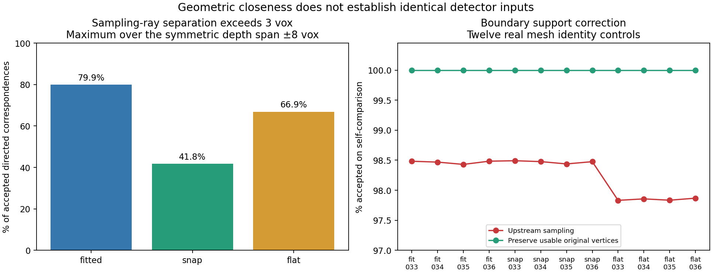

# Suite des investigations — 24 novembre 2026

## Résultat principal

Cette contribution ajoute une expérience géométrique sur les douze surfaces
publiques PHerc. 0211, corrige un défaut d'admission entre producteurs et propose
un calcul statistique plus informatif pour les audits sans événement observé.
**Aucune nouvelle lettre n'est confirmée.** Les travaux visent à rendre les
économies de calcul de la pipeline vérifiables avant d'écarter des régions.

L'intégration contient les dernières modifications A03 du RFC, au commit
`4c4433ef058078c4a59af38326d759d7036bb1eb`, et conserve les preuves et conclusions
historiques de notre [campagne visuelle](../visual_discovery_20261124/README.md).
La suite combinée passe **168 tests**, sans échec, erreur ni test ignoré :
[reçu de vérification](native_tests_followup.json).

## Avancées observées dans les autres branches

La branche d'intégration Claude a repris notre contribution native `9ac322f`
dans le merge `fa42c87e07dd9959b36787a4c1a290eb73cfd524`. La PR #7 demeure ouverte
et en brouillon ; son intégration dans cette branche de travail est distincte
d'une fusion dans la branche principale.

[Adaptive-075](https://github.com/JorisViaudQuantAI/Scrollprize/blob/70c3efdbf540e3e11786c11fa693c25a8cfaa7be/collab/chatgpt-adaptive-075.md)
a ajouté trente régressions A03 et vérifié 146 tests avec notre contribution
native précédente. Son admission de batch vérifie les dépendances, les contrôles,
les tentatives, les budgets et les liens vers les adjudications. Elle reste une
vérification des preuves déclarées et des fichiers, sans authentification
indépendante de la lecture humaine ou du sens scientifique des cartes.

[Gemini-010](https://github.com/JorisViaudQuantAI/Scrollprize/blob/e310d6e188b42d196662bc75ffec61f36335ae24/collab/gemini-010.md)
annonce un aplatissement ARAP sur CPU. Sur son contrôle géométrique 0211/w033,
le cisaillement au 95e percentile passe de 41,581° à 7,371° ; 0,0784 % des
triangles restent retournés. Sept préparations 0826, totalisant 37,4939 cm²,
passent ses critères géométriques. Il s'agit de surfaces préparées pour un
examen futur, pas de cette surface déjà examinée pour son texte.

Gemini rapporte aussi quatre nouvelles exécutions GPU sur 0125, soit
16,0317 cm² : trois résultats classés négatifs par son inspection et une zone,
`z15344_w035`, encore indécise. L'accord de deux familles de modèles est rapporté
avec un IoU de 0,393596 et des nuages visuels larges. Les images correspondantes
ne figurent pas dans le commit ou les liens examinés : **nous n'avons pas fait
de relecture visuelle indépendante de cette nouvelle zone**. Le ledger
synchronisé reste à 90,9026 cm² ; le total annoncé de 106,9343 cm² dépend encore
de l'adjudication et de la synchronisation. Les surfaces annoncées par Gemini
n'ont pas été recalculées dans notre travail.

Les exports complets des bandes 0211 coarse/fine, avec cartes natives appariées
et masques, restent absents des nouveaux éléments examinés. Les données
géométriques publiques permettent néanmoins l'expérience suivante.

## 1. Déduplication géométrique : défaut corrigé et limite mesurée

Le [rapport complet](geometry_dedup_followup/README.md), le
[protocole gelé](geometry_dedup_followup/PROTOCOL.md) et les
[résultats détaillés](geometry_dedup_followup/result.json) couvrent les quatre
windings w033–w036, dans chacun des états fitted, snap et flat. Nous avons
étudié les 36 paires orientées distinctes et les 12 comparaisons d'identité,
sur des données dont les hashes sont vérifiés. L'exécution finale a pris
70,40 secondes sur CPU. Aucun volume CT ni modèle d'encre n'a été exécuté.

### Le test échouait partiellement sur une surface comparée à elle-même

La méthode omettait certains sommets aux bords des cellules valides :
**2 935 rejets sur 164 591 occurrences de sommets utilisables**, soit 1,783 %.
Le sommet pouvait appartenir à une cellule valide d'un côté, mais être omis
par le masque de la cellule choisie pour le rééchantillonnage bilinéaire.

Le [petit patch fourni](geometry_dedup_followup/gemini_preserve_vertices.patch)
conserve les sommets originaux utilisables dans le nuage cible. Il rétablit
**100 % sur les douze comparaisons d'identité**. Il a également été appliqué
et testé sur une copie du véritable module Gemini : ce n'est pas seulement
un résultat de notre réimplémentation. Le patch est prêt pour leur intégration.

### Une correspondance acceptée n'établit pas l'équivalence des entrées

Nous avons mesuré l'écart entre les deux trajectoires de prélèvement, après
alignement du signe des normales, sur une plage symétrique de ±8 voxels.

| Préparation | Correspondances acceptées entre surfaces distinctes | Écart maximal supérieur à 3 voxels |
|---|---:|---:|
| Fitted | 1 860 | 1 486 — 79,89 % |
| Snap | 32 971 | 13 778 — 41,79 % |
| Flat | 4 729 | 3 163 — 66,88 % |
| Ensemble | **39 560** | **18 427 — 46,58 %** |

Ces observations comptent des correspondances orientées ; elles ne représentent
ni une surface physique unique ni des lettres. Elles ne prouvent pas que les
valeurs CT diffèrent ou que du texte serait perdu. Elles montrent précisément
que le critère de proximité ne garantit pas des coordonnées de prélèvement
identiques. Pour réutiliser exactement une inférence, il faut vérifier les
entrées ordonnées et le contrat complet de rendu, de contexte et de modèle.

La confrontation à la surface publique de référence n'a trouvé que **quatre**
cas « source proche, cible éloignée », parmi 13 588 occurrences dont la source
est proche. Les quatre cibles restent à l'intérieur de ±8 voxels. Le résultat
ne doit donc pas être présenté comme une démonstration de pertes massives de
texte. Les 166 cas inconnus et 1 585 intermédiaires sont conservés séparément.

J'ai examiné les trois atlas, soit les 48 cartes. Ils montrent la répartition
spatiale des correspondances et des catégories géométriques. Ils ne sont pas
des images d'encre et aucune forme n'y est interprétée comme une lettre.

## 2. Admission : la validation ne dépend plus du lecteur choisi

Un contre-exemple synthétique utilise le véritable backend Gemini avec un
batch REGISTER→GEOMETRY, CONTROL→COARSE→RANK. Son COARSE ne contient qu'un ordre,
déclaré par le producteur, sans le plan d'audit A02 requis.

| Lecture du même batch | Avant correction | Après correction |
|---|---|---|
| Lecteur Gemini | COARSE `COMPLETE`, RANK `READY_FOR_OPERATOR` | COARSE et RANK bloqués |
| Lecteur partagé | COARSE et RANK bloqués | COARSE et RANK bloqués |

Le contrôle A03 relit désormais les règles communes de l'enveloppe, du spec,
du reçu et des fichiers CAS, immédiatement après la lecture du backend. Un
coût devenu incomplet est déclaré comme tel et arrête le batch ; il n'est pas
transformé en coût nul fiable. Le chemin ne déclenche aucune exécution.

Les [sept probes](producer_interop_result.json) et le
[guide de migration](PRODUCER_INTEROP.md) documentent aussi les divergences de
schéma, la simple déclaration d'un taux d'audit, une NPY synthétique contenant
un NaN, le mélange de modèles pour une paire et les tentatives contradictoires.
Ils ne démontrent aucune corruption d'une vraie carte publiée.

Le head Gemini `e310d6e` conserve exactement le même adaptateur. Un raccordement
supplémentaire reste à faire : son nouvel aplatisseur émet
`parameterization_method="mit_arap_2d"`, mais l'adaptateur refuse cette valeur.
Le rejet est reproduit. Ajouter un nom à une liste autorisée ne suffirait pas
à valider la qualité géométrique ou la sensibilité d'un modèle.

## 3. Audit : une borne exacte sur le total, sans lancer de modèle

Le [comparateur statistique](followup_a03/README.md) calcule la probabilité
maximale d'observer zéro événement pour un nombre total donné de cas manqués,
en tenant compte de leur répartition inconnue entre strates. Il conserve le
sondage sans remise et utilise des fractions exactes.

| Plan synthétique, zéro événement partout | Somme des bornes Bonferroni | Nouvelle borne totale à 95 % |
|---|---:|---:|
| Deux strates de 20, trois audits chacune | 26/40 | **14/40** |
| Six strates de 20, trois audits chacune | 90/120 | **17/120** |

La borne existante demeure valide et fournit aussi une information simultanée
par strate ; la nouvelle méthode vise uniquement le total. Elle a été vérifiée
contre une énumération exhaustive de **5 511 plans**, puis relue indépendamment.
Le gain concerne le calcul statistique, pas une amélioration mesurée du rappel.
Les tirages doivent être figés et indépendants entre strates, les unités
disjointes, les revues complètes et toutes résolues à zéro. Le module reste
hors des décisions de promotion de la pipeline.

## État des livrables et prochaine preuve utile

Les **168 tests combinés** comprennent les trente régressions A03 récemment
publiées et vingt-deux nouveaux tests de cette contribution. Le contrôle
numérique des cartes géométriques passe ; une vérification indépendante retrouve
exactement les 48 masques et les indices de voisinage du code Gemini épinglé.
Les 53 fichiers de notre ancienne preuve visuelle restent également valides.

La prochaine expérience qui pourrait justifier un gain de temps mesuré est un
test de rappel sur les **mêmes cartes natives**, avec contrôles positifs,
unités explicites et comparaison coarse/fine. Le défaut de support peut être
corrigé dès maintenant ; les correspondances géométriques peuvent proposer des
recouvrements à vérifier. Une conclusion « rien à lire ici » nécessite encore
ces preuves sur les données d'encre.
