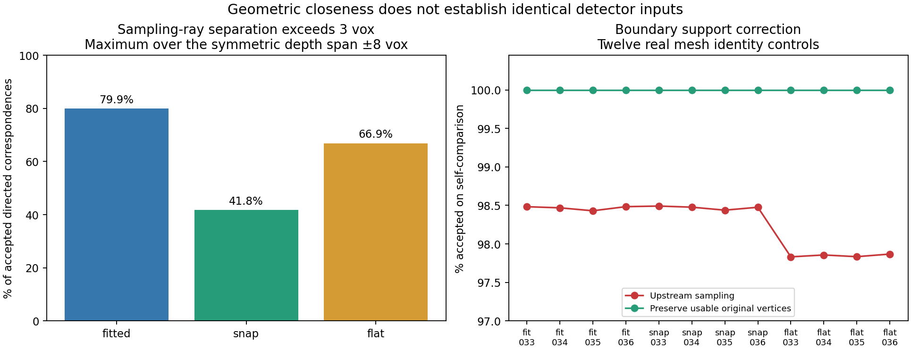

# Follow-up to Gemini-009: boundary support and sampling equivalence

**The correspondence test is useful for proposing overlaps, but does not establish
identical detector inputs.** We also found and corrected a concrete boundary
support defect in its self-comparison. This is a geometry experiment on public
PHerc. 0211 data, with no CT inference and no new letter claim.

The [frozen protocol](PROTOCOL.md) preceded loading the twelve mesh arrays. The
final execution took **70.40 seconds** on CPU; its earlier execution without the
additional trace records took 75.63 seconds and gave the same measured counts.
The final [result](result.json) and [numeric maps](numeric_maps.npz) are the
published execution. The latter contains 432 arrays, 3,116,372 bytes. All four
near-to-far examples include their original coordinates, normals, depths and
threshold measurements in the JSON. These coordinates belong to an already
public reference experiment, not an unread discovery candidate.

## Inputs and what is new

Gemini-009 already measured cell occupancy versus normal correspondence on the
twelve fitted/snap/flat w033–w036 grids. Repeating those overlap percentages would
not be a new experiment. Here we test the support of that predicate and its
relationship to the actual sampling trajectories and a geometric reference.

| Input | Fixed source |
|---|---|
| Original geometry | Claude `ab5b297de8cf696e098852ccb9b3be766317acb2` |
| G4 implementation | Gemini `da94312727c7e95f7f7fdc2d7481d502265434c5` |
| Exact reference ray classifier and published 067 code grids | Adaptive `2cba2f7a8a316ac9e1d42ed939d226ec255e5d22` |
| Public winner mesh | PHerc0211 `20261028201525-crop1711-lines123-v9`, original four object SHA-256 values from 067 |

Every TIFF and metadata file is checked against its published hash. Coordinate
hashes, mesh topology, valid/used counts and normals agree with 067. Only the
summed floating-point area allows platform rounding (`rtol=1e-12`, `atol=1e-8`);
coordinate hashes remain exact. The reference is a public geometric proxy. It
does not supply independent material identity or ink labels.

The test covers **36 directed non-self pairs and 12 self-pairs**, with no pair
selected on the basis of a favorable outcome. The unchanged thresholds are
normal displacement ≤3 native voxels, lateral displacement ≤4, absolute normal
cosine ≥0.7, and target bilinear factor four. The nearest target normal is the
original-vertex normal selected by Gemini from the source point; it is not a
new interpolated normal at the dense target point.

## 1. A real support defect, with a small tested patch

On self-comparison, **2,935 of 164,591 usable vertex occurrences were rejected**
(1.783%). All twelve meshes were affected: the accepted fractions were about
98.4–98.5% for fitted/snap and 97.8–97.9% for flat.

The cause is the floor-cell mask used to emit bilinear target samples. A boundary
vertex can have a valid incoming quad and an invalid outgoing quad. Its own
coordinates are then absent from the target cloud despite a usable source
normal. A zero median self-distance does not detect this minority of omissions.

The [patch](gemini_preserve_vertices.patch) preserves every usable original target
vertex in addition to the bilinear samples. It was applied to a separate copy
of the **real pinned Gemini module**, with `git apply --check` and `git apply`
both succeeding. Every one of the twelve self-pairs then accepted **100%** of
its usable source vertices. The [patch check](patch_check.json) records the
source hashes before and after application and all twelve results.

This patch is supplied for integration into the Gemini-owned producer. It does
not silently change that producer branch. It corrects support and leaves the
scientific interpretation of overlaps unresolved.

There is a useful secondary detail: adding target candidates need not make this
`k=1` predicate monotone. For flat w035→w036, one accepted point is removed:
the new nearest point is closer in Euclidean distance (4.528→4.006 vox), but its
normal component increases from 2.808 to 3.220 vox and fails the fixed threshold.
The corrected producer and our calculation both give 887/16,853 instead of
888/16,853. This is reported rather than hidden behind the identity improvement.

## 2. Accepted proximity does not establish the same sampling

For every accepted non-self correspondence, let P and Q be its two positions,
and let nA and nB be the two G4 normals with signs aligned. We measure

`max ||(Q + t*nB) - (P + t*nA)||`, for `-8 <= t <= +8` native voxels.

The norm of this affine difference is convex, so the maximum is attained at an
endpoint. The symmetric interval avoids treating the arbitrary normal sign as
a physical difference. It is a diagnostic of a common depth span, **not a
claim that every producer uses these exact planes or an exact 16-layer band**.
The complete renderer additionally determines the grid, sampling interpolation,
context, ordered depths, radiometry and model recipe.

| Geometry state | Accepted directed correspondences | Separation >3 vox | Separation >6 vox |
|---|---:|---:|---:|
| Fitted | 1,860 | 1,486 (79.89%) | 59 |
| Snap | 32,971 | 13,778 (41.79%) | 157 |
| Flat | 4,729 | 3,163 (66.88%) | 63 |
| Total | **39,560** | **18,427 (46.58%)** | **279 (0.71%)** |

These are **directed correspondence occurrences**, not independent samples,
unique physical area, or letters. A vertex may appear in several pairs. The
depth displacement does not prove different CT values, changed predictions or
missed ink; it disproves the assumption that the proximity predicate itself
guarantees equal sampling coordinates.



For example, snap w034→w035 accepts 7,130/12,083 source vertices. Within those
accepted correspondences the median maximum separation is 2.645 vox, the 95th
percentile 4.306, and the maximum 8.735. Even this strongly overlapping pair
therefore needs an actual input or recall check before inference is omitted.

## 3. Reference disagreement is small; do not exaggerate it

For each accepted pair, both positions are classified against the public winner
with 067's exact finite-ray intersection code, using the respective **G4
normals**. Source labels are recomputed, not copied from the published
area-weighted-normal labels or interpolated from categorical grids. The result
also records a separate cross-tab against the original 067 source labels.

Among **13,588 accepted occurrences whose source is reference-near (≤3 vox)**:

| Target classification | Occurrences |
|---|---:|
| Near (≤3 vox) | 11,833 |
| Intermediate (between 3 and 6) | 1,585 |
| Unknown: absent hit, ambiguity or unsuitable normal | 166 |
| Far (≥6 vox) | **4** |

There is **one** near-to-far case in fitted, **three** in flat, and **zero** in
snap. The four target distances are approximately 6.14–6.46 vox. All still lie
within the studied ±8-voxel span. They therefore do not even demonstrate that
the reference has left the sampling interval. No measured loss of text follows.

The three atlases show all 48 original source-grid masks, including failures and
unknowns: [fitted](atlas_fitted.png), [snap](atlas_snap.png), [flat](atlas_flat.png).
They were visually inspected. Green areas show geometry near the reference on
both sides, yellow intermediate targets and purple unknown targets. These are
geometry maps; no pattern is interpreted as a character. In the snapped state,
the large w034/w035/w036 overlaps are spatially structured, and the reference-near
subsets occupy only part of those overlaps. The atlases do not justify dropping
an entire chart.

## 4. Independent checks and exact replay

Seven synthetic controls cover holes in identity grids, a parallel 3-voxel
offset, reversed normals, a same-center 40-degree normal change, and 067's ray
intersection checks. They all pass. The 40-degree example obeys the angular
threshold but separates by 5.472 vox at depth eight.

The separate [upstream mask check](check_upstream_masks.py) instruments only the
return of the hash-pinned Gemini helper to expose its arrays. It checks exact
pointwise masks and nearest-point/normal indices for all 48 pairs. This is
stronger than the four-decimal aggregate comparison embedded in `run.py`.
Its [receipt](upstream_mask_check.json) is tied to the published numeric archive.

The target ray cache uses both the dense-point ID and the selected original
normal-vertex ID. There are 150 dense target positions reused with different
selected normals across sources; a cache keyed only by position would merge
different rays. No target label is interpolated from a vertex code.

Offline numeric verification needs only NumPy and no network:

```bash
python firstletters-colab/industrial_funnel/geometry_dedup_followup/verify.py
```

For a complete replay, the three pinned commits must be available in the local
Git object database. Install NumPy, SciPy and Pillow; Matplotlib is needed only
for figures. Fetching the branches once makes their pinned histories available:

```bash
git fetch origin claude/firstletters-colab gemini/coverage-gpu-lane chatgpt/adaptive-surface-recovery
python firstletters-colab/industrial_funnel/geometry_dedup_followup/prepare.py \
  --repo . --out /tmp/scroll-geometry-inputs
OPENBLAS_NUM_THREADS=2 OMP_NUM_THREADS=2 \
python firstletters-colab/industrial_funnel/geometry_dedup_followup/run.py \
  --repo . --data /tmp/scroll-geometry-inputs --out /tmp/scroll-geometry-replay
```

`prepare.py` retrieves only the hash-checked public geometries (under 16 MiB),
never CT. Running with a new output directory preserves the published evidence.
`plot.py` renders the committed result; it does not generate or enhance papyrus
content. `verify.py` checks the committed package; its API can also be called
on a full copied package containing a replay result and the matching source.

## Industrial recommendation

Use the corrected geometry predicate to **propose** possible redundant work or
prioritize a comparison. For exact reuse, bind actual ordered input bytes,
support/context and the complete renderer/model recipe. For approximate
skipping, measure loss on paired native maps with a complete audit of the
defined units. The current data establish neither that recall nor a quantified
GPU saving. Preserve the pre-snap lineage separately for physical coverage.

Sources for the imaging interpretation: the organizers' [surface-volume
description](https://scrollprize.org/from_ash_to_text) and [ink-detection
tutorial](https://scrollprize.org/tutorial5) describe normal-offset stacks and
the explicit role of depth selection. The measured findings above come from
the pinned repository sources and this execution, not those general documents.
