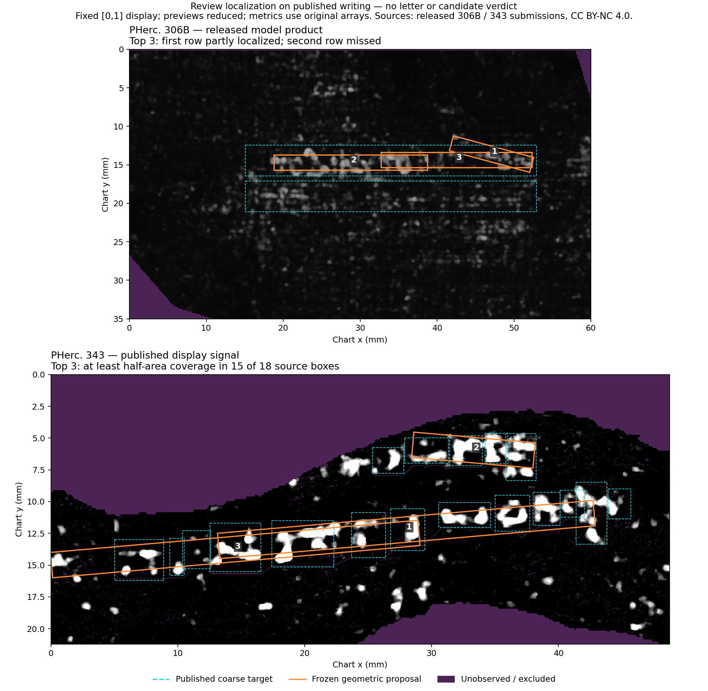

# Measured localization on released sparse writing

**From a source — this experiment.** The fixed geometric ranker produces useful
review crops, and also misses published writing near the top of its ranking.
It is ready as an additional review aid. These results do not authorize skipping
a map, calling a map blank, counting recognized letters or claiming a calibrated
false-positive rate. The numerical record is [results.v1.json](results.v1.json).



## Design and provenance

**From the recorded protocol.** [protocol.v1.json](protocol.v1.json) records the
complete configuration, five named cases, exact method/evaluator hashes and
prepared map/mask hashes before any new ranking output. Its SHA-256 is
`c0b6b2ec02bb0b029e41dc8bcf5ad8dd9fca0bf6f580963b0c174a4bfd393edf`.
This is a local freeze, not an externally timestamped preregistration. The
[source-selection protocol](../line_controls/protocol.json) preceded source
pixel inspection; its [explicit coverage amendment](../line_controls/amendment-001.json)
followed discovery of NaN coverage but preceded ranking. No parameter or target
was tuned after seeing these results.

**From a source.** The [control documentation](../line_controls/README.md) links
the original submissions, source annotations and physical scale. PHerc. 306B
uses a released model-product map at 8.64 micrometres per pixel. PHerc. 343 uses
only signal reconstructed from a published, already contrast-adjusted display
at the same stated scale. These are different input types, not comparable
calibrated detector probabilities. Neither surrounding unlabelled context is
certified text-free.

**From our implementation.** The ranking helper receives only the map, validity
mask, physical spacing and fixed configuration. It does not receive the source
target boxes. Coverage is calculated afterward from unions of proposal bands
on the original grid. Every case uses thresholds 0.25, 0.50 and 0.75; 36 angles
at five-degree increments; at least four mark slots and an 8 mm minimum chain.
See [all defaults](../line_review/README.md). These choices are an uncalibrated
review recipe, not an optimized or transferred winning-submission threshold.

## Actual CPU results

**From the frozen run.** Ranking used OpenCV with four threads and a 180-second
per-map ceiling. The reported times cover `rank_map`, excluding downloads,
packet writing and model inference. All searches completed without reaching
their unique-mark-set cap. They are five related cases from two published
scrolls, not five independent controls.

| Case | Ranking seconds | Proposals | Result and limitation |
| --- | ---: | ---: | --- |
| 306B full context | 6.517 | 88 | Top three bands cover 88.9% of the first supplied row centreline and 0% of the second. |
| 306B author-described blank strip | 0.067 | 0 | Approximately 5 mm wide: a horizontal chain cannot meet the fixed 8 mm minimum. Very weak specificity evidence. |
| 306B depth-shuffle control | 0.119 | 0 | Uses common support; its scores never reach the first 0.25 threshold. A perturbation control, not ordinary blank papyrus. |
| 306B claim with shuffle-common support | 3.599 | 47 | Identical mask to shuffle. At ten bands, row centreline coverage is 66.1% and 92.3%. |
| 343 display signal | 4.871 | 63 | At three bands, 15/18 source letter-location boxes have at least 50% supported-area coverage. |

**From the frozen coverage measurements.** The full 306B context has these
retained misses:

| Number of bands | First supplied row centreline covered | Second supplied row centreline covered |
| ---: | ---: | ---: |
| 1 | 15.9% | 0.0% |
| 3 | 88.9% | 0.0% |
| 5 | 89.0% | 0.0% |
| 10 | 89.0% | 55.8% |

**From the frozen coverage measurements.** The number of 343 source boxes with
at least half their valid area covered is 7/18 at one band, 15/18 at three,
15/18 at five, and 18/18 at ten. These boxes indicate published letter
locations; they are neither independent crops nor pixel-accurate ink labels.
Those counts are **not recognized letters**. A broad band can cover a box
without resolving a glyph. Source display thresholding has already made the
343 test easier than finding faint writing in an unprocessed model output.

**My inference.** Keep the full map available even when no proposal survives,
and retain the existing dense-row view as a separate review aid. Do not use
the first three or five proposals as a stopping rule. No controlled comparison
of human review time or performance against the older dense-row score was
performed, so no speedup or accuracy gain over that baseline is claimed.

## Audit and integrity-only replay

**From the audit.** [REVIEW.md](REVIEW.md) checks source coordinates and a
hand-counted validity/union example. It also states the weak blank-strip
geometry and a post-hoc selected-area description. Those extra area summaries
were not frozen primary metrics. The author of the ranker performed the metric
audit; it is not external validation.

**From the subsequent software review.** A separate agent identified a possible
live-file race: a producer could replace a map after it was loaded, leaving an
incorrect input hash in the receipt. No such change was observed in this fixed
public-control run. Production code now checks hashes before loading and after
ranking. The evaluator also rechecks each case at consumption time, rather
than relying only on a check before processing all five cases. This changes
integrity checks only, not the ranking mathematics or configuration.

The exact v1 sources are retained in
[v1_sources/line_review/review.py](v1_sources/line_review/review.py) and
[v1_sources/line_evaluation/evaluate.py](v1_sources/line_evaluation/evaluate.py).
The second run is explicitly a post-outcome robustness replay; it is not a
new blind validation. Its [protocol](protocol.v2.json), [results](results.v2.json)
and [comparison receipt](integrity_replay.json) are retained. **All result fields
except runtime are exactly identical in all five cases.** AST comparisons also
confirm that every non-`main` function and class in the ranker and evaluator is
unchanged. The original measurements, misses and source snapshots remain intact.

## Reproduce

Dependencies: NumPy, OpenCV and Pillow; Matplotlib is needed only for the figure.
The extractor downloads approximately 180 MB once. Full review packets contain
native arrays and are kept outside Git.

```bash
python firstletters-colab/line_controls/prepare.py \
  --output-dir /tmp/public-line-controls
python firstletters-colab/line_evaluation/evaluate.py \
  --data /tmp/public-line-controls \
  --output /tmp/public-line-evaluation
```

For the exact original source version, replace the second script with
`firstletters-colab/line_evaluation/v1_sources/line_evaluation/evaluate.py`.
That snapshot resolves its matching sibling ranker automatically. The new
run records new timestamps and timing; all substantive inputs and defaults
are hash-recorded. Use a new output directory each time.

Regenerate the figure from the original frozen results with:

```bash
python firstletters-colab/line_evaluation/plot_public.py \
  --data /tmp/public-line-controls \
  --results firstletters-colab/line_evaluation/results.v1.json \
  --output /tmp/public-line-controls-figure.png
```

**From the figure implementation.** Cyan boxes come from published annotations;
orange polygons are the first three frozen proposals; purple means excluded
support. Only the display preview is reduced. Score values use the supplied
[0,1] scale, without an additional contrast stretch. The numerical coverage
uses original arrays, not figure pixels. The root agent visually inspected the
two full overviews and this figure after the run.

## Attribution and licence

The derived figure is **CC BY-NC 4.0**, following the
[343 release](https://github.com/Nieuwlaar/pherc343-first-letters/tree/e8370f1f88a211166056df62ea6fcfffe4a1063e)
and [306B data licence](https://github.com/SirProdigle/pherc0306b-first-letters/blob/feabff6c54f95bd8e52a90e0a7a76881ee67d4cc/LICENSE-DATA).
Credit those source repositories and Vesuvius Challenge data. Changes are
documented crop/orientation/opacity extraction, preview reduction, physical
axes and diagnostic overlays. Neither image is a new find. The adapted method
retains its [upstream MIT notice](../line_review/LICENSE.source).
