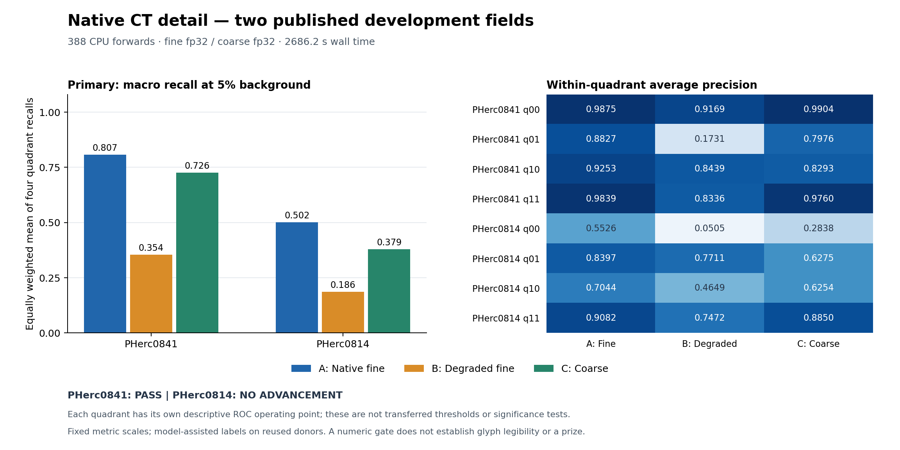

# Native detail: positive control signal, failed two-field advancement

**From the executed [result](evidence/result.json):** the frozen experiment completed all 388 CPU FP32 forwards, including four calibration forwards and 384 field forwards, in 2,686.20 seconds. It acquired 716,792,347 new application-body bytes through 378 requests including redirects. Peak process RSS was 2,772,472 KiB, about 2.64 GiB. No training or unread-region inference occurred.

The [public freeze](https://github.com/JorisViaudQuantAI/Scrollprize/commit/80c109fdac5162df1f6c92094dd73bb1c24949a1) predates the new model/CT acquisition and predictions. Runner, protocol and selection are unchanged.

## Primary result

**From the [receipt](evidence/result.json):** recall below is the equally weighted mean of four quadrant recalls. Each quadrant uses its own descriptive 5% known-background operating point. These are label-informed ROC summaries, not thresholds transferred to an unread scroll.

| Public control | A: native fine | B: degraded fine | C: coarse | A relative missed-ink reduction vs C | Frozen field decision |
| --- | ---: | ---: | ---: | ---: | --- |
| PHerc. 0841 | 0.806674 | 0.353970 | 0.725668 | 29.5285% | Pass |
| PHerc. 0814 | 0.502051 | 0.186247 | 0.378733 | **19.8494%** | **Fail** |

**From the [protocol](protocol.json) and result:** advancement required at least 20% relative missed-ink reduction in **both** fields, alongside the other fixed conditions. The second field's exact value is `0.1984940895832341`. It is below `0.20`; it has not been rounded into a pass. The combined advancement decision is false.

**From the [result](evidence/result.json):** full-field AP for A/B/C is 0.932843 / 0.706685 / 0.903214 on PHerc. 0841, and 0.793773 / 0.599132 / 0.705748 on PHerc. 0814. A has nonworse AP than C in seven of eight quadrants, but lower fixed-background recall in three of eight. Relative macro missed-ink reductions versus B are 70.0748% and 38.8084%.

**My inference:** native detail supplies a useful signal within these controls. The fixed fine model performs much worse after the specified degradation; switching to the dedicated coarse model recovers some of that loss. This is evidence for the tested information/preprocessing effect, not a general physical-resolution law or unseen-scroll sensitivity. A/B includes requantization and nearest expansion; A/C changes the checkpoint. All arms use fine-derived CT, so C is not an actual native coarse-scan experiment.

## Visual review and follow-up decision

**From root's complete fixed-scale review, recorded in [followup_decision.json](evidence/followup_decision.json):** the native fine maps show broader continuity of labelled strokes than degraded fine. PHerc. 0814 still has missing labelled shape, saturated regions and tile discontinuities. The small fields do not establish new letter legibility. No per-image stretch was used.

**From the recorded operational decision:** the separately fixed coarse fallback required both fields to have macro recall at least 0.50 and full-field AP at least 0.80, plus visual review. PHerc. 0814's C values, 0.378733 and 0.705748, fail that rule too. The prepared PHerc. 1203 extension was **not executed**: zero new unread-scroll CT payload requests and zero unread-scroll forwards. Its private locations and source geometry are not published.

## Independent verification and limits

**From the [independent review](evidence/independent_review.json):** 216 retained source assets, six predetermined A/B/C input reconstructions, all four fine-to-common score reductions, the exact labels/support, the pilot decision and all gates checked successfully. All 428 recomputed scalar comparisons matched within 2.22e-16. [verify_result.py](verify_result.py) contains the checker; it makes no model or network calls.

The check reconstructs paired inputs from retained fine tensors; per-forward tensors were not separately saved. It recomputes scores' metrics without regenerating the model predictions. It does not certify independent biological truth.

**From [Claude 012](../../collab/claude-012.md):** the team now records PHerc. 0841 w00 as training-exposed for Hecate and Studio. Treat this as development/input-path evidence; exact inherited region exposure remains an ancestry question. Both fields use model-assisted labels and previously used donors. The newly frozen field selection does not make these independent photographic controls.

For interpretation, the separate architecture and depth-collapse experiments, and the team handoff, see [ChatGPT 021](../../collab/chatgpt-021.md).
