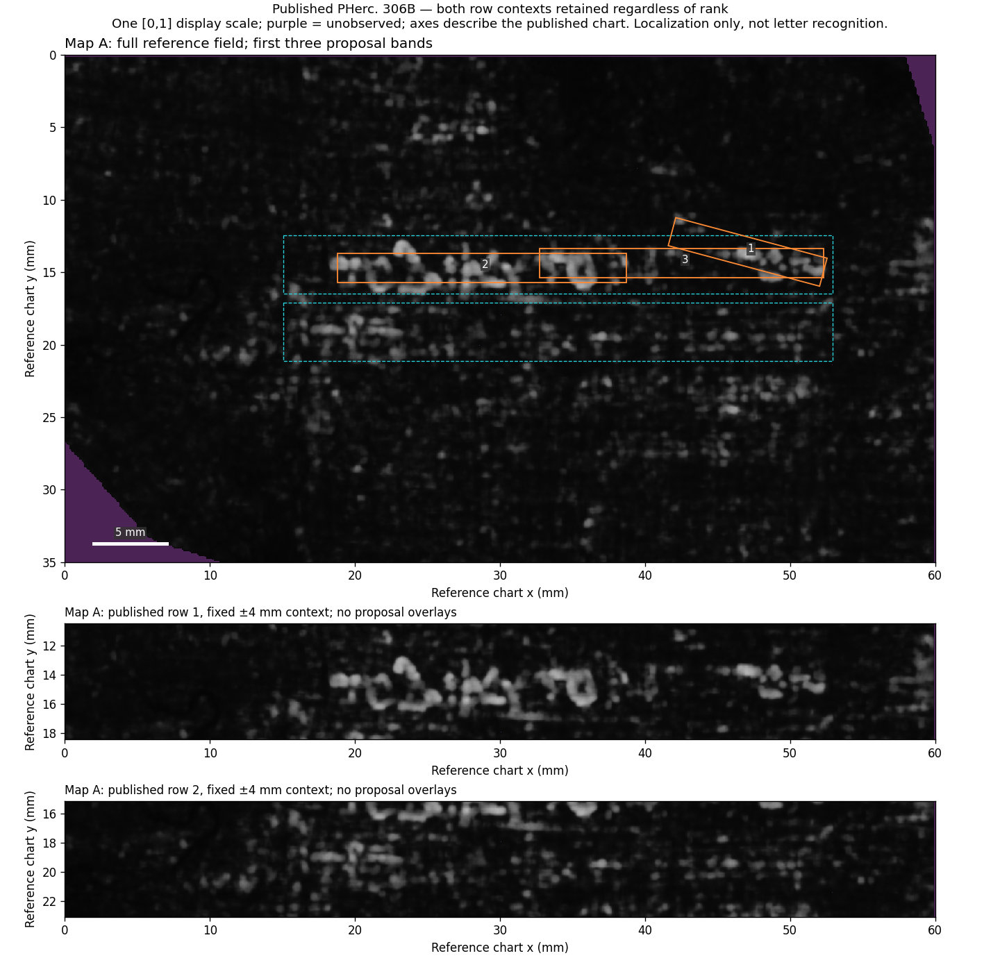

# Both published 306B row contexts, at one physical scale

**From a source — repository experiment.** The published 306B reference map
produces 88 line proposals with the unchanged helper. Its first five proposals
cover none of the lower published row's centreline. The individual proposal
with greatest overlap with that row is rank **11**, covering **94.25%** of its
supported centreline. The first individual proposal covering at least half of
the upper row is rank 2. These are geometric overlaps with published coarse
annotations, not letter recognition. The full receipt is
[results.reference.json](results.reference.json); the previous top-1/3/5/10
measurements are reproduced exactly from
[the frozen earlier evaluation](../line_evaluation/results.v1.json).

**My inference.** A shortlist can hide the lower row even on this published
positive control. Preserve both source-defined contexts and the full map in
every review packet, whatever their rank. This diagnostic answers
[Codex's request](../../collab/codex-009.md) to retain the lower row and supports
[the request for two actual tile placements](../../collab/codex-010.md).



The figure uses the full reference width for all three panels. Its row strips
are centred on the two published row centres with a fixed ±4 mm vertical
context. They have no proposal overlays. The full panel shows the same map,
the two coarse source target bands in cyan, the first three proposal bands in
orange, and a 5 mm scale bar. Purple means unobserved. All panels share the
same millimetre scale; the renderer measures and asserts that property before
saving. The displayed range stays [0,1], without a new contrast stretch.
The image is a reduced preview; the external packet retains the native arrays.

## Sources and timing

**From a source.** The
[released PHerc. 306B repository](https://github.com/SirProdigle/pherc0306b-first-letters/tree/feabff6c54f95bd8e52a90e0a7a76881ee67d4cc)
provides the
[image sidecar with its two row centres and 8.64 µm sampling](https://github.com/SirProdigle/pherc0306b-first-letters/blob/feabff6c54f95bd8e52a90e0a7a76881ee67d4cc/submission/PHerc0306B_20250521133212_w074own_touchup_V5Rc.json).
Its
[released model maps](https://huggingface.co/datasets/Prodigle/pherc0306b-first-letters/tree/f435998b55269762942a979052044309b29650ac/results)
include the TRACE × mean-A-hn product used here. The extraction, source hashes,
reading-order transformation, coarse target construction and prediction
validity correction are already recorded in the
[public-control inventory](../line_controls/inventory.json) and
[public-control documentation](../line_controls/README.md). We add no handwritten
ink masks, letter labels, or judgments about the unannotated surrounding area.

**From a source — experiment record.** [protocol.json](protocol.json) fixes this
diagnostic after the earlier ranking failure was known and before any new
tile-placement outputs were inspected. This is a **post-outcome reference
diagnostic**, not a new blind validation or an independent positive control.
The source inventory, complete input bytes, protocol and unchanged ranker are
hash checked or recorded. `rank_map` never receives the source target boxes.

The complete published reference field is 4,051 × 6,945 pixels. The renderer
uses its chart coordinates, not a claim of distortion-free distances on the
original papyrus. Code enforces the pinned frame and source hashes in
single-map mode. Pair mode checks declarations and bytes; it cannot certify
that an upstream model really ran or that an upstream coordinate transform
was correct.

## What the row report measures

For each source row, the report keeps two different denominators explicit:

- **Whole-source support:** `source_box_support_fraction` and
  `source_centreline_support_fraction` divide the observed target pixels by the
  entire original published target area or horizontal centreline. Cropping
  the field does not reduce this denominator.
- **Conditional coverage:** `box_coverage` and `centerline_coverage` divide
  pixels covered by the proposal bands by the target pixels actually observed
  on the common validity mask. They describe only the available part of a row.
  Missing target support produces `null`, never a zero-coverage negative.

The full original target here is 4,382 pixels wide. For example, even a
completely valid 1,158-pixel-wide subfield can observe only
`1158 / 4382 ≈ 26.43%` of that centreline. Conditional coverage of 100% inside
that field would still leave most of the published row unassessed. Validity
holes can reduce the available fraction further.

The top-1/3/5/10 metrics use the **union** of the first K band polygons,
rasterized on the complete supplied pixel grid. Their union is clipped by the
same validity mask. The report also gives every individual proposal's overlap
and three descriptive ranks: first nonzero centreline overlap, first
**individual** proposal with at least 50% centreline coverage, and greatest
individual overlap (earlier rank breaks a tie). One-pixel overlap is enough
for the first of these ranks; it is not evidence that a row was read.

**From a source — measured reference result.** Both published centrelines have
complete support in the full reference field. The measured coverage is:

| Published row | Top 1 centreline | Top 3 | Top 5 | Top 10 | First individual ≥50% | Greatest individual overlap |
| --- | ---: | ---: | ---: | ---: | ---: | ---: |
| Upper | 15.93% | 88.93% | 89.00% | 89.00% | Rank 2 | 52.72%, rank 2 |
| Lower | 0% | 0% | 0% | 55.77% | Rank 11 | 94.25%, rank 11 |

Full box coverage, exact denominators, all 88 per-proposal overlaps, the
unmodified proposals and code hashes remain in
[the reference receipt](results.reference.json). A missing row at any K is
explicit. The ranker can emit proposals elsewhere, and this corpus does not
label those locations as false positives. No sensitivity, specificity,
false-positive rate, glyph count or prize-candidate verdict is estimated.

## Reproduce the published reference

Dependencies are NumPy, OpenCV and Matplotlib; source preparation additionally
uses Pillow. Start from the repository root. Choose fresh directories outside
every Git worktree. The following paths are placeholders:

```bash
python firstletters-colab/line_controls/prepare.py \
  --output-dir /absolute/path/outside/git/public-line-controls

python firstletters-colab/row_context/diagnostic.py \
  --public-controls-root /absolute/path/outside/git/public-line-controls \
  --output-dir /absolute/path/outside/git/public-row-context

python -m unittest discover -s firstletters-colab/row_context -p 'test_*.py' -v
```

An already prepared source directory can be reused; no second download is
needed. An output directory that already exists is refused. The external
packet contains `review.html`, `report.json`, the fixed-scale PNG, each full
native map, `common_valid.npy`, and native row-context crops with masks. The
committed preview and receipt are only for this already published source.
Unpublished review packets belong outside Git.

The nine small tests exercise source-to-field coordinate translation, native
polygon rounding, missing centrelines, entirely unobserved targets, preservation
of whole-row denominators after cropping, explicit lower-row omission, and
rejection of mismatched pair recipes or duplicate tile-grid residues. The
reference replay additionally checks exact agreement with the frozen earlier
top-K counts and fractions. See [verification.json](verification.json).

## Two actual tile placements

**From a source — planned experiment.** The sibling
[tile-phase runner](../tile_phase/README.md) plans independent A-hn seed-0
inference for two actual tile origins. Those single-member maps are a different
quantity from this released fused product. No genuine phase-pair result is
included in the reference receipt above.

Run the comparator only after both native model outputs and their masks exist:

```bash
python firstletters-colab/row_context/diagnostic.py \
  --pair-manifest /absolute/path/outside/git/tile-field/pair.json \
  --output-dir /absolute/path/outside/git/tile-field-review
```

[example_pair_manifest.synthetic.json](example_pair_manifest.synthetic.json)
documents the contract. Its repeated-digit hashes and sample recipe are
**placeholders, not measurements**. Use the producer's actual receipts.

Each map needs a SHA-256-checked `.npy` score array, a boolean `.npy` mask, and an
explicit tile origin. The shared `run_signature` must be identical in every
field and must include model/checkpoint identity, source frame, ordered depth
indices, preprocessing, fusion, precision, augmentation recipe, tile shape,
stride, and coverage policy. The two tile origins must have distinct residues
modulo the declared stride. This metadata check cannot distinguish a real
rerun from falsely labelled arrays; the producer must supply the execution
receipt. A translated output image is not a second tile placement.

`field_box_yxyx` refers to the **prepared reading-orientation reference chart**.
The currently planned field is `[1268,3356,2618,4514]`, a 1,350 × 1,158-pixel
rectangle, or 11.664 × 10.00512 mm. The producer's tile origins refer to its
declared **native source raster before the vertical reading-order flip**.
The producer must put both output maps in the same declared reference field;
this comparator does no registration, spatial interpolation or image shifting.

The common mask is the intersection of the two input masks. Both rankings,
both metrics and both previews use exactly that intersection. Each original
mask's support and the common support are recorded. The figure keeps both full
reference chart panels and both fixed row contexts; any part outside the
supplied subfield stays purple. The report includes per-row B-minus-A top-K
coverage differences and paired descriptive ranks. A rank change is a
localization change, not an improvement in letter recognition.

### Fixed-field feasibility check

**From a source — postselection diagnostic.** Before new phase outputs, the
already chosen field above was cropped from the released fused product and
passed through the unchanged helper. It yielded **six proposals**, without
search truncation. That establishes only that this crop can support proposals
under the fixed helper on this particular map. It does not establish that
single A-hn inference will produce proposals or improve row coverage.
[feasibility.reference.json](feasibility.reference.json) records the packaged
script's matching replay,
source hashes and recipe. No coordinate search or parameter tuning followed
this check, and the tile-phase protocol was not amended.

```bash
python firstletters-colab/row_context/feasibility.py \
  --public-controls-root /absolute/path/outside/git/public-line-controls \
  --output /absolute/path/outside/git/fixed-field-feasibility.json
```

## Attribution and limits

**From a source.** The source maps and derived image are subject to the
[306B data licence, CC BY-NC 4.0](https://github.com/SirProdigle/pherc0306b-first-letters/blob/feabff6c54f95bd8e52a90e0a7a76881ee67d4cc/LICENSE-DATA).
Credit the original PHerc. 306B submission contributors and Vesuvius Challenge
data. This preview adds source-defined cropping, the documented reading-order
flip and validity mask, reduced display sampling, fixed physical axes and
proposal overlays. It is not raw CT, an independently annotated answer key,
or a transcription. Nothing in this folder is a new unread-scroll finding.
