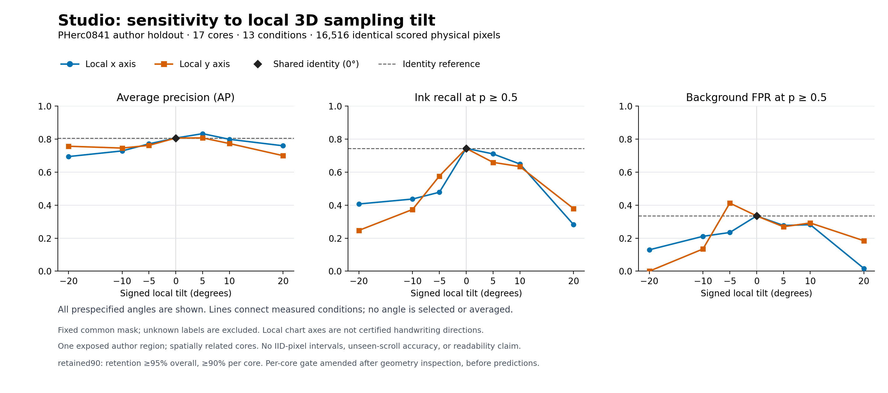

# Q33: real native-CT tilt can suppress ink without a large AP alarm

Date: 2026-11-24. Public PHerc0841 author donor control; released Studio
soft-loss checkpoint. This is an executed sampling-sensitivity experiment,
not a new reading or an independently certified text-positive control.

**Completed: 221 CPU forwards on 17 fixed cores and 13 conditions, with exact
identity reproduction and independent score verification.** Nine of the twelve
tilted conditions lose more than 10 percentage points of recall at the fixed
0.5 threshold. Four lose more than 0.05 AP. Those two criteria are not
interchangeable: one condition retains AP 0.757 while detecting none of the
5,167 annotated ink pixels in the mixed cores at that threshold.

The small pooled AP gain at x +5 degrees is also insufficient to recommend an
angle correction. Its AP on the mixed cores changes only from 0.6393 to 0.6402,
while their recall falls from 66.94% to 53.96%. Pure controls and mixed controls
must remain visible separately when interpreting the aggregate.



## 1. Scope and non-overlap

The new operation is a rigid rotation of the **actual curved sampling tube in
native XYZ**, including its surface anchors and normals, followed by fresh CT
sampling. This is the out-of-plane part of Q33. It differs from the completed
Q10 XY scale test and adaptive049 in-plane shear. It does not repeat the polar
winding, 0211 fitting/regrowth, on-sheet gate, or optical scale-transfer lanes.

The control comes from the pinned public author release
`841-expanded-layer-03-approved-r000001`. It is a repeatedly evaluated donor
holdout. The metadata and its label lineage do not justify treating it as an
independent paleographic certification of legible letters. This experiment
does not score line readability or explain a particular pattern of dot rows.

The 17 cores were selected from annotations before any tilted inference:
all 11 cores having at least 512 known pixels and an ink fraction in [0.1,0.9],
plus three pure-ink and three pure-background controls selected by deterministic
within-class maximin distance. No core was substituted after geometry checks.

## 2. What was frozen and what changed during preflight

The code, scoring policy, selected controls, and receipts/hashes identifying
the source geometry and prepared inputs were committed **before detector
inference**. The large input arrays and raw mesh remain outside git:

- Freeze commit: [`ae294dc44aa949132cb62b9f1b724514786a524d`](https://github.com/JorisViaudQuantAI/Scrollprize/commit/ae294dc44aa949132cb62b9f1b724514786a524d).
- Protocol SHA256: `d56864f88ba32302344c1858f9a53cf4c1f203b64a7b28fab980105535793a80`.
- Full protocol: [protocol.json](evidence/protocol.json).

There was one explicit geometry-only amendment. The initial requirement of
at least 95% known-pixel retention in every core failed in four cores, whose
retentions were 91.4–93.8%. Preparation stopped before a model was loaded. The
failure is preserved in [failed_geometry_gate_initial95.json](evidence/failed_geometry_gate_initial95.json).

The revised `retained90` policy required at least 95% globally and 90% in each
core. It kept the exact same 17 cores, 13 conditions, source geometry, 0.01
native-voxel residual tolerance and intersection mask. This coverage policy
was chosen after geometry inspection and before any detector score. It was
therefore **informed by the geometric preflight**, rather than prospectively
fixed before that inspection. Neither residual tolerance nor model thresholds
were relaxed.

The retained population is:

| Labels | Original selected cores | Scored common subset | Retained |
|---|---:|---:|---:|
| Ink | 8,416 | 8,217 | 97.64% |
| Background | 8,640 | 8,299 | 96.05% |
| All known | 17,056 | 16,516 | 96.83% |

The 540 excluded known labels comprise 199 ink and 341 background. They are
stored separately from the 352 original unknown labels. Minimum per-core
known retention is 91.40625%. Every metric below uses the **same 16,516 labels
in every condition**. The excluded subset can be associated with local folds
and annotation structure; its absence is a limitation of the measured domain.

## 3. Native acquisition and physical correspondence

The original mesh and affine recipe were recovered from the first 8 MiB of a
1.377 GB public archive. Five whitelisted members, totaling 215,700 bytes,
matched their pinned source-index hashes. The full archive was not downloaded
or claimed to have been verified from its prefix.

Native CT sampling used 55 complete uint8 Zarr chunks plus the array metadata,
115,343,599 source-body bytes in total. Each received object has a SHA256
receipt. Every positive-weight trilinear interpolation corner was available;
missing chunks were not silently padded. Stored masked zeros remain data
values, not independent proof of original acquisition coverage. Source-body
hashes do not establish an atomic snapshot of the entire remote volume.

The 16 depth positions are [-8,...,+7] times 9.366 micrometres. The reference
surface is at index 8, not the midpoint of the asymmetric stack. XY annotation
pitch is 9.36 micrometres. The author FP32 geometry, trilinear interpolation,
uint8 rounding and normalization conventions are preserved.

There are thirteen conditions: identity and signed rotations of 5, 10 and
20 degrees about each positive local chart tangent at the patch centre. The
centre reference surface point is the rotation pivot. These tangents are not
asserted to be handwriting directions or mutually orthogonal everywhere.

For an original reference point X=S(u,v), the inverse solves

```text
S(u',v') + d' n(u',v') = C + R^T (X - C).
```

The model output is read bilinearly at the resulting local (u',v'). Labels are
never interpolated. This is the actual curved mesh and varying normal field,
not a flat-plane cosine approximation. Residual, local Jacobian orientation,
conditioning, depth and output support are checked before scoring.

Retained reference points lie between -5.632 and +5.521 native voxels in the
[-8,+7] depth band. The largest readback displacement is 2.642 model pixels.
Reference-point correspondence does not locate the actual ink in 3D: an ink
feature at S+h*n may move both in depth and into a neighbouring column. The
outer 128-square context may also leave the reference sheet while the central
32-square remains supported. The experiment consequently combines pose,
normal, depth, context and resampling effects.

### Why some inverse points abstain

All 865 arm-by-pixel inverse rejections were residual failures; none were
caused by depth limits, output margin, a failed Jacobian or invalid source
mesh geometry. Many occur at discontinuous normal transitions between
bilinear mesh cells. The intersection removes duplicated failures across arms.

An independent investigation of the worst core reproduced its physical
residuals through the actual author evaluator. A bounded search over nine
neighbouring cells found no acceptable root for the ten worst tested cases.
This supports retaining those abstentions; it does not prove global absence
of a root or global injectivity of the sampling tube. See
[independent_geometry_review.json](evidence/independent_geometry_review.json)
and [check_inverse_seams.py](check_inverse_seams.py).

## 4. Results on the common population

AP and AUC measure ranking; recall and FPR below use the predeclared threshold
0.5. AP differences are absolute fractions, not relative percentages.

| Condition | AP | Difference vs identity | Recall | Background FPR |
|---|---:|---:|---:|---:|
| Identity | 0.806586 | — | 74.38% | 33.49% |
| x -20 degrees | 0.694340 | -0.112246 | 40.71% | 12.94% |
| x -10 degrees | 0.728539 | -0.078047 | 43.70% | 21.11% |
| x -5 degrees | 0.771291 | -0.035295 | 47.82% | 23.44% |
| x +5 degrees | 0.833083 | +0.026498 | 71.05% | 27.69% |
| x +10 degrees | 0.798917 | -0.007669 | 64.93% | 28.15% |
| x +20 degrees | 0.759646 | -0.046940 | 28.23% | 1.63% |
| y -20 degrees | 0.756908 | -0.049677 | 24.70% | 0.00% |
| y -10 degrees | 0.745747 | -0.060839 | 37.37% | 13.44% |
| y -5 degrees | 0.762176 | -0.044410 | 57.60% | 41.26% |
| y +5 degrees | 0.807424 | +0.000839 | 65.92% | 26.91% |
| y +10 degrees | 0.773210 | -0.033376 | 63.38% | 29.21% |
| y +20 degrees | 0.699756 | -0.106830 | 37.93% | 18.42% |

The predeclared engineering thresholds identify:

- Four of twelve tilted conditions with AP loss greater than 0.05.
- Nine of twelve with recall loss greater than 0.10.
- One with FPR increase greater than 0.03: y -5 degrees, +0.077720.

These are descriptive magnitudes, not significance tests. No IID-pixel
confidence interval is appropriate for seventeen spatially related cores in
one compact, repeatedly used annotation region.

The identity AP 0.806586 belongs to this common subset. The previous 53-core
Q10 AP 0.753604 is a different population and must not be treated as evidence
of an improvement. On the original selected 17 cores before the common-mask
exclusions, historical identity AP was 0.804923.

## 5. Two aggregation traps relevant to the other lanes

### A low FPR can coexist with complete failure on mixed ink

At y -20 degrees, aggregate AP is 0.756908, only 0.049677 below identity. An
AP-loss-only check with a strict 0.05 boundary would not flag it. Aggregate
FPR is also zero. Nevertheless, recall falls to 24.70%; on the eleven mixed
cores, recall is **zero out of 5,167 ink labels** at the fixed threshold. The
remaining true positives come from two pure-ink controls.

The same pattern is less extreme at x +20 degrees: AP loss is 0.046940, while
recall on mixed cores falls to 5.61%. Passing the AP magnitude check is not a
definition of a tolerable geometric perturbation. A quiet probability map is
not sufficient evidence that an unseen surface is blank.

### The x +5 degree pooled AP gain does not establish a correction

| Population and metric | Identity | x +5 degrees | Change |
|---|---:|---:|---:|
| All labels: AP | 0.806586 | 0.833083 | +0.026498 |
| Mixed cores pooled: AP | 0.639325 | 0.640181 | +0.000856 |
| Mixed cores: recall | 66.94% | 53.96% | -12.99 points |
| Mixed cores: FPR | 48.88% | 40.42% | -8.46 points |
| Pure ink: recall | 86.98% | 100.00% | +13.02 points |
| Pure background: FPR | 0.00% | 0.00% | unchanged |

At threshold 0.5, the mixed cores lose 671 true positives and remove 481 false
positives. Pure-ink controls gain 397 true positives, all in author core 288;
the other two remain unchanged. AP is not additive by group, so these counts
do not mechanically attribute all of the aggregate AP gain to that core.

Seven individual mixed-core APs increase and four decrease; their median
change is +0.025884, and one core loses 0.147100. The median of separate
per-core APs differs from AP calculated on the pooled mixed population. Both
are retained, along with the full per-core metrics. The positive aggregate
result is an exploratory observation, not a selected angle, deployment rule,
or independent validation of improved text recovery.

## 6. Existing training augmentation is a different operation

The exact checkpoint already used `scroll-shift-v2`. The released training
path includes XY D4 operations, extra +/-8-degree planar rotation, XY scales
0.9–1.1, a depth shift up to one plane, depth-ramp coefficients up to 0.4 plane
per axis, depth-scale variation and a small smooth depth field. The synthetic
depth displacement is tapered by sin(pi*z/15) to zero at stack endpoints.

These operations warp the sixteen existing planes. They do not rigidly rotate
the curved surface and normals and retrieve fresh CT context. The present
losses therefore do not show that the model lacked geometric augmentation,
and should not be attributed to an isolated failure of network rotational
invariance. The code path is documented in the pinned
[checkpoint README](https://github.com/priyankaranke/vesuvius-studio-multiscroll-cpt/blob/bf66f753176792a966bca17822629fb8821f20c8/studio-softloss-20261023/README.md),
[training loop](https://github.com/priyankaranke/vesuvius-studio-multiscroll-cpt/blob/bf66f753176792a966bca17822629fb8821f20c8/studio-softloss-20261023/train_softloss.py),
[selected augmentation wrapper](https://github.com/priyankaranke/vesuvius-studio-multiscroll-cpt/blob/bf66f753176792a966bca17822629fb8821f20c8/donor-studio-resunet-scratch-20260926/sparse_data.py)
and [warp implementation](https://github.com/priyankaranke/vesuvius-studio-multiscroll-cpt/blob/bf66f753176792a966bca17822629fb8821f20c8/pherc1447-architecture-study-20260906/scroll_augment.py).

The methodological motivation for native sampling and explicit interpolation
contracts is also discussed in [research.md](research.md), with the official
Vesuvius FAQ and the primary medical-imaging interpolation literature.

## 7. Verification, runtime and reusable artifacts

The actual inference used CPU FP32, two workers and four threads per worker,
batch size one. There were 17 identity and 204 tilted forwards, completed in
542.783 seconds wall time. No retraining, angle search after inspecting
predictions, ensemble, threshold tuning or unread-scroll inference was used.

Verification completed:

- Seven independent geometry tests, including a curved closed-form inverse,
  asymmetric depth anchoring, metric pitch and a true normal-seam gap.
- All 4,456,448 identity input bytes exactly equal to the published author
  crops reconstructed independently from the prepared tile manifest.
- Every identity core prediction exactly equal to the corresponding historical
  prediction; maximum probability and AP difference both zero.
- Independent manual four-corner readback, exactly equal to the archived
  aligned probabilities on the common scored support for every one of the
  221 output maps. Pixels outside that support are not certified by this audit.
- Independent NumPy/sklearn recalculation of metrics, labels, masks, selection
  and gates; maximum metric disagreement 3.33e-16. Full and portable audits
  each pass 2,367 scalar comparisons.

Evidence and reproduction:

- [README.md](README.md): complete acquisition/preparation/inference commands.
- [results.json](evidence/results.json): full precision pooled and per-core results.
- [pooled_metrics.csv](evidence/pooled_metrics.csv) and
  [group_metrics.csv](evidence/group_metrics.csv): review tables.
- [scored_arrays.npz](evidence/scored_arrays.npz): probabilities, original and
  masked labels, common mask, condition names and public author indices.
- [independent_review.json](evidence/independent_review.json) and
  [archive_review.json](evidence/archive_review.json): completed audits.
- [inference_receipt.json](evidence/inference_receipt.json): all forward records.
- [export_manifest.json](evidence/export_manifest.json): export hashes.

The score archive is 779,864 bytes, SHA256
`9558cfd463a3d3450e0b7499321df8fa49b64fa83286c984666da2dfac5fe6ad`.
It supports score replay without downloading CT or the 893 MB checkpoint.
The portable audit does not by itself certify CT acquisition or inference;
the complete acquisition and inference receipts remain separate.

## 8. Decisions for follow-up

Keep the zero-angle production reference. No result here supports automatic
mesh rotation by x +5 degrees, or a universal angular tolerance. The first
useful integration is the benchmark and its explicit mixed/pure reporting,
so a detector's loss of ink recall cannot be mistaken for a clean negative.

A future corrective experiment should distinguish surface-anchor error,
normal-ray direction and depth-window placement, then validate any chosen
correction on an independently registered public text control. Q33's claim
about dot rows and actual readability remains open. Fitting, winding and
unread-candidate decisions remain with their existing lanes.
