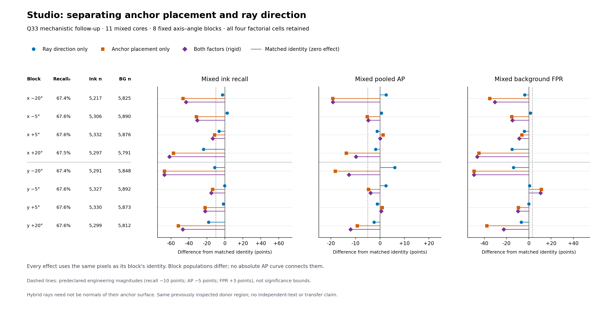

# Studio pose factors — completed native-CT experiment

Completed on 2026-11-24. This is the mechanistic follow-up to the
[Q33 rigid-tilt experiment](../studio_oblique_stress/RESULTS.md), on the same
public PHerc0841 author controls and the same fixed Studio checkpoint.

## Finding and decision

**Moving surface anchors, with the original sampling directions retained,
reduces pooled mixed-core recall by more than 10 percentage points in all
eight tested axis/angle blocks. Rotating only the sampling directions crosses
that threshold in three blocks.** Rotating both factors together also crosses
it in all eight blocks. The threshold is fixed at probability 0.5 throughout.

At **y -20 degrees**, anchor-only and rigid interventions both detect **zero
of 5,291 retained mixed-core ink pixels**. Direction-only retains 56.2276%
recall, versus 67.4353% for the paired identity. Its mixed AP nevertheless
improves from 0.638070 to 0.699044. A better score ranking therefore does not
guarantee preservation of detections at the fixed operating threshold.

The supported conclusion concerns these particular sampling operators. It
does not establish an intrinsic sensitivity to anchors versus normals at
equal spatial displacement: the two factors have different geometric lever
arms. Anchor motion also changes reference depth, context and readback.
No angle correction, ensemble, production change or new readable-text claim
is selected from this development panel.

## What was fixed and executed

The parent result was committed in
[`bfc9372`](https://github.com/JorisViaudQuantAI/Scrollprize/commit/bfc9372ded39809fc79388a6017ef768e91bc17a).
The new protocol, preparation receipts, source identities, masks and input
hashes were committed in
[`e2641df`](https://github.com/JorisViaudQuantAI/Scrollprize/commit/e2641df5f799bfc8dc7f8cd0e065520034db694e)
**before any new detector forward**. No primary gate, core, angle, threshold
or scored mask was changed after seeing the new outputs.

The design retains all 17 original cores: 11 with both ink and background
annotations, three pure-ink controls, and three pure-background controls.
Each scored core is 32 by 32 pixels within a 128 by 128 input context with
16 depth planes. The eight blocks are -20, -5, +5 and +20 degrees around
each of the two positive local chart tangents. They are not certified
handwriting directions.

For original surface S, signed direction n, pivot C, and rotation R, the
ideal-coordinate construction is:

```text
F_ab(u,v,d) = C + R^a (S(u,v)-C) + d R^b n(u,v)
```

| Cell | Anchors | Sampling directions | Implementation name |
| --- | --- | --- | --- |
| 00 | Original | Original | `identity` |
| 01 | Original | Rotated | `normal_only` |
| 10 | Rotated | Original | `anchor_only` |
| 11 | Rotated | Rotated | `rigid` |

The off-diagonal cells are deliberate interventions in the sampler. Their
sampling directions need not be normals of the modified anchor surface.
They do not represent four certified anatomical reconstructions or a change
in CT acquisition.

The actual FP32 construction preserves the original author's rounded tube
offsets. Identity and rigid cells delegate exactly to the historical code;
the hybrids use `C + R^a(S32-C) + R^b(N32-S32)`, then round to FP32.
The reference depth is index 8 of offsets [-8,...,+7], not the midpoint of
the asymmetric stack. Details and independent analytic oracles are in
[research.md](research.md) and [factor_geometry.py](factor_geometry.py).

| Execution item | Observed result |
| --- | ---: |
| Fresh identity sentinels, before new factor cells | 3 forwards |
| Direction-only cells | 136 forwards |
| Anchor-only cells | 136 forwards |
| **Total newly executed model forwards** | **275** |
| Unique historical outputs reused | 153: 17 identities + 136 rigid |
| Inference wall time | 646.061 seconds |
| Runtime | CPU FP32 evaluation, 2 workers, 4 threads each |
| New native-CT bytes downloaded in this preparation | 4,194,304 |
| Native source bodies used, including cached objects | 119,537,903 bytes in 58 objects |

CT was sampled at native coordinates for each new arm; a preflattened input
slab was not warped. The 153 historical input references were reconstructed
from native CT and their byte hashes matched before reuse. The three fresh
identity sentinels (author indices 250, 288, 326) had maximum probability
differences **0, 0, 0** against historical identity outputs.

There are 425 unique condition/core outputs in the factorial design. The
portable archive contains 544 maps because the same 17 identity predictions
are represented in each of eight blocks. Repetition in the archive is not
an additional inference or an independent observation. The three sentinels
are new executions of existing identity conditions.

## Coverage and paired populations

Originally the 17 cores contain 8,416 ink labels, 8,640 background labels and
352 unknown labels. Unknowns remain unscored. Each primary block uses one
mask shared by its four cells, formed before inference from geometric
readback and source support.

The frozen gates are at least **95% of known labels globally within each
block**, and **90% in every core within each block**. All eight blocks pass.
Reference-point readback must also satisfy the unchanged 0.01-native-voxel
residual limit, depth bounds, output margin and local geometric checks.

| Block | Retained ink, all cores | Retained background, all cores | Known labels excluded | Known retention | Minimum core retention |
| --- | ---: | ---: | ---: | ---: | ---: |
| x -20 | 8,261 | 8,523 | 272 | 98.4053% | 96.4844% |
| x -5 | 8,378 | 8,630 | 48 | 99.7186% | 96.8750% |
| x +5 | 8,400 | 8,616 | 40 | 99.7655% | 97.8516% |
| x +20 | 8,345 | 8,506 | 205 | 98.7981% | 94.9219% |
| y -20 | 8,348 | 8,544 | 164 | 99.0385% | 96.8750% |
| y -5 | 8,399 | 8,631 | 26 | 99.8476% | 99.0040% |
| y +5 | 8,400 | 8,599 | 57 | 99.6658% | 98.5060% |
| y +20 | 8,361 | 8,486 | 209 | 98.7746% | 96.6797% |

These excluded known labels are distinct from the 352 original unknown
labels. The score arrays encode both as unscored, but original labels and
geometry masks are also retained so their provenance can be recovered.

**The pixel populations differ between blocks.** Every contrast below is
paired against the identity on that block's own mask. Absolute AP values
must not be compared across angles as if the populations were identical,
nor directly equated to the parent's global-mask scores.

The predeclared secondary intersection across all blocks retains 8,050 ink
and 8,152 background labels: **94.992964%** of known labels, with minimum
core retention 89.0625%. It is a separate descriptive population and is not
the primary mask subject to the per-block 95%/90% gates. It is not used to
replace the primary analysis.

## Primary result: recall on the eleven mixed cores

Recall is the fraction of retained annotated ink pixels with probability
at least 0.5. Counts and recall below refer only to the eleven original
mixed cores; pure controls are excluded from this primary measure.

| Block | Mixed ink n | Mixed background n | Identity recall | Directions only | Anchors only | Both / rigid |
| --- | ---: | ---: | ---: | ---: | ---: | ---: |
| x -20 | 5,217 | 5,825 | 67.395% | 64.692% | 20.778% | 24.171% |
| x -5 | 5,306 | 5,890 | 67.584% | 70.109% | 35.771% | 36.732% |
| x +5 | 5,332 | 5,876 | 67.648% | 61.215% | 56.245% | 54.107% |
| x +20 | 5,297 | 5,791 | 67.453% | 43.779% | 10.176% | 5.758% |
| y -20 | 5,291 | 5,848 | 67.435% | 56.228% | 0.000% | 0.000% |
| y -5 | 5,327 | 5,892 | 67.618% | 67.430% | 53.914% | 52.412% |
| y +5 | 5,330 | 5,873 | 67.636% | 66.041% | 45.516% | 45.666% |
| y +20 | 5,299 | 5,812 | 67.617% | 49.575% | 15.795% | 20.664% |

The engineering flags use the frozen magnitudes, not statistical significance:

| Intervention versus its paired identity | Recall loss >10 points | AP loss >0.05 | FPR increase >3 points |
| --- | ---: | ---: | ---: |
| Directions only | 3/8 | 0/8 | 0/8 |
| Anchors only | 8/8 | 5/8 | 1/8 |
| Both / rigid | 8/8 | 4/8 | 1/8 |

The 3/8, 8/8 and 8/8 primary recall flag counts persist on the stricter
secondary global intersection. Thus these particular classifications are
not solely a consequence of the different masks between blocks. This is
a sensitivity analysis on the same data, not independent replication.

These are pooled mixed-core outcomes, not statements that every core changes
uniformly. For example, at x +5 only two of the eleven individual mixed
cores lose more than 10 recall points under anchor-only; local increases
also occur in some blocks. Complete per-core scores and confusion counts
are in [results.json](evidence/results.json).



The figure shows differences from each block's paired identity. Dashed
lines denote the declared engineering magnitudes; they are not confidence
bounds. Values to nine decimal places are in
[factorial_cells.csv](evidence/factorial_cells.csv) and
[factorial_contrasts.csv](evidence/factorial_contrasts.csv); the retained
numerical precision is available in [results.json](evidence/results.json).

## Conditional effects and interactions

For metric M on one block's shared population:

```text
Direction effect, original anchors: M01 - M00
Direction effect, rotated anchors:  M11 - M10
Anchor effect, original directions: M10 - M00
Anchor effect, rotated directions:  M11 - M01
Interaction:                       M11 - M10 - M01 + M00
```

All entries in the following table are **percentage points of mixed recall**.

| Block | Direction effect, original anchors | Direction effect, rotated anchors | Anchor effect, original directions | Anchor effect, rotated directions | Interaction |
| --- | ---: | ---: | ---: | ---: | ---: |
| x -20 | -2.703 | +3.393 | -46.617 | -40.521 | +6.095 |
| x -5 | +2.525 | +0.961 | -31.813 | -33.377 | -1.564 |
| x +5 | -6.433 | -2.138 | -11.403 | -7.108 | +4.295 |
| x +20 | -23.674 | -4.418 | -57.278 | -38.022 | +19.256 |
| y -20 | -11.208 | 0.000 | -67.435 | -56.228 | +11.208 |
| y -5 | -0.188 | -1.502 | -13.704 | -15.018 | -1.314 |
| y +5 | -1.595 | +0.150 | -22.120 | -20.375 | +1.745 |
| y +20 | -18.041 | +4.869 | -51.821 | -28.911 | +22.910 |

Direction changes after anchor rotation change recall by -4.418 to +4.869
points in these blocks. At original anchors, their effect reaches a loss
of 23.674 points. The effect therefore depends on the state of the other
factor. Directions cannot be dismissed as harmless or irrelevant.

Positive interaction is not necessarily a recovery. At y -20, both cells
with rotated anchors already have zero recall; changing directions there
adds exactly zero. The +11.208-point interaction follows algebraically from
that floor and the loss caused by direction-only. At y +20, direction
rotation loses 18.041 points at original anchors but adds 4.869 points at
rotated anchors, giving +22.910 points of interaction.

The coordinate formula itself is additive in the two factors in ideal
arithmetic. The composite mapping from these coordinates through CT
resampling, the network, condition-specific readback and the chosen metric
is nonlinear. An interaction in the metric is neither a new coordinate
interaction nor a percentage of anatomical failure explained.

## AP and false-positive rates change the interpretation

| Block | Mixed AP, identity | Mixed AP, directions only | Mixed AP, anchors only | Mixed AP, rigid |
| --- | ---: | ---: | ---: | ---: |
| x -20 | 0.636618 | 0.661790 | 0.443762 | 0.444728 |
| x -5 | 0.638577 | 0.644836 | 0.586534 | 0.590750 |
| x +5 | 0.640901 | 0.629200 | 0.653659 | 0.642285 |
| x +20 | 0.641392 | 0.624285 | 0.503464 | 0.543691 |
| y -20 | 0.638070 | 0.699044 | 0.455163 | 0.511826 |
| y -5 | 0.640077 | 0.664563 | 0.593252 | 0.601674 |
| y +5 | 0.640878 | 0.630364 | 0.649936 | 0.646122 |
| y +20 | 0.643922 | 0.619707 | 0.551543 | 0.524130 |

Three cases matter for subsequent agent decisions:

- **y -20, directions only:** mixed AP gains 0.060974, while recall loses
  11.208 points and mixed FPR falls from 49.3844% to 35.5164%. Unlike the
  parent's pooled x +5 AP gain, this improvement is present within the
  mixed population itself. It is worth retaining as a ranking observation,
  without selecting this transform from an already exposed donor panel.
- **y -20, anchors only and rigid:** both have 0 true positives / 5,291 ink
  pixels and 0 false positives / 5,848 background pixels at threshold 0.5.
  A zero-FPR output here misses all annotated mixed-region ink. Its nonzero
  AP reflects score ordering below that threshold, not recovered detections.
- **y -5, anchors only:** recall falls by 13.704 points while mixed FPR
  rises by 11.253 points, to 60.4209%. The rigid cell loses 15.206 recall
  points while FPR rises by 10.489 points. Anchor perturbations therefore
  do not merely lower all scores uniformly.

At x +5, anchor-only mixed AP improves by 0.012758 but recall loses 11.403
points; rigid mixed AP improves by just 0.001384 while recall loses 13.541
points. All-core APs for those cells are 0.832503 and 0.831863, versus
0.805154 for identity. The primary mixed recall avoids interpreting these
pooled gains as preserved detection of ink inside mixed regions.

The exported tables retain all-core, mixed, pure-ink and pure-background
results separately. Single-class AP does not measure class separation;
undefined denominators remain undefined. No average of group APs is used
as a replacement for pooled AP.

## Why this is not an equal-amplitude causal decomposition

For unit direction n and depth d, the direction-only displacement obeys

```text
||d(Rn - n)|| <= 2 |d| sin(|theta| / 2).
```

At the most distant input depth, |d| = 8 native voxels, that bound is
approximately 0.70 voxel for 5 degrees and 2.78 voxels for 20 degrees.
It is zero on the reference surface. These are analytic bounds, not
measured displacement quantiles of the curved inputs.

Anchor displacement instead obeys

```text
||R(S-C) - (S-C)|| = 2 rho sin(|theta| / 2),
```

where rho is distance to the rotation axis. Its lever arm extends over
the 128-square spatial context. Equal angles therefore do not imply equal
spatial perturbations. Moving anchors also changes the depth and chart
position at which the original labelled reference point is read back.

Furthermore, the annotations identify surface columns, not the true 3D
ink depth. A feature displaced from the nominal surface can move to another
column even when the reference anchors remain fixed. A converged local
inverse and present CT interpolation corners do not prove anatomical
sheet identity or global invertibility.

This panel comes from one repeatedly inspected author region. Its parent
results informed the angle set and emphasis on mixed recall. The freeze
protects the new execution from score-driven changes; it does not make
this an untouched holdout. No pixel-IID confidence interval, donor-transfer
claim or fraction of causal attribution is reported.

## Independent verification and reproducible evidence

Eight geometry tests passed before inference, including independent planar
and cylindrical analytic oracles, FP32 compatibility at large coordinate
origins, missing geometry and singular hybrid directions. The planar
oracles distinguish secant/tangent from cosine/sine readback. The new
geometric construction was not inferred solely from model scores.

One independent auditor, which imports none of the producer, sampler or
geometry modules, was run in two modes. Both passed **8,436 scalar checks**
with maximum absolute metric discrepancy **3.33e-16**. They are two modes
of the same auditor, not two independent implementations.

| Full audit check | Observed result |
| --- | ---: |
| Original author identity input bytes | 4,456,448 exact |
| Direction-only depth-zero planes | 136 exact against author identity |
| Historical input references | 153 matching materialized input arrays and hashes |
| New aligned probabilities manually read back from full outputs | 270,854 values, bitwise exact |
| Parent probabilities manually read back on the new masks | 270,854 values, bitwise exact |
| Parent values newly admitted outside the old global mask | 7,356 values, bitwise exact |
| Identity sentinel maximum differences | 0, 0, 0 |
| Receipt forward count | 275 new forwards |

The 7,356 count includes repeated values across blocks and both reused cells;
it is not a count of independent or unique pixels. This extended readback
matters because the previous Q33 audit covered only its narrower old global
mask. The historical full outputs and mappings were rechecked here on
every newly scored block's support.

The full auditor checks materialized inputs, output maps, code/source/model
identities and receipts; **it does not independently repeat native CT
acquisition**. The runner's preparation performed the native reconstruction.
Portable mode certifies archive arithmetic, populations, retained parent
fields and contrasts, not original network execution or source download.

Key evidence:

- [protocol.json](evidence/protocol.json), SHA256
  `c502a6bad514c4bd8eb63656f93cdcd82d62b58b11250ea290c8cf7690b7ef5c`.
- [scored_arrays.npz](evidence/scored_arrays.npz), 1,924,035 bytes, SHA256
  `ba7e0f6a1032f8eb00cdb83d75b07613ce5c8cd496880943aaaf5652e3c372c2`.
- [results.json](evidence/results.json), all groups, per-core scores,
  engineering flags, conditional contrasts and the secondary population.
- [independent_review.json](evidence/independent_review.json) and
  [archive_review.json](evidence/archive_review.json), with explicitly
  different full/portable scopes.
- [inference_receipt.json](evidence/inference_receipt.json),
  [sentinel_check.json](evidence/sentinel_check.json),
  [native_receipt.json](evidence/native_receipt.json), and
  [parent_reuse_input_checks.json](evidence/parent_reuse_input_checks.json).
- [export_manifest.json](evidence/export_manifest.json), containing exact
  hashes of all primary/secondary CSV files and both figure formats.

From the repository root, the portable audit requires only NumPy and
scikit-learn plus the checked-in parent and current evidence:

```bash
python firstletters-colab/studio_pose_factors/audit_results.py \
  --output firstletters-colab/studio_pose_factors/evidence \
  --protocol firstletters-colab/studio_pose_factors/evidence/protocol.json \
  --parent-evidence firstletters-colab/studio_oblique_stress/evidence \
  --expected-protocol-sha c502a6bad514c4bd8eb63656f93cdcd82d62b58b11250ea290c8cf7690b7ef5c \
  --report /tmp/studio_pose_factors_replay.json
```

Choose a fresh `--report` filename; the auditor refuses to overwrite an
existing review.

Full inference reproduction and source paths are described in
[README.md](README.md). The full audit additionally accepts `--prepared`,
`--parent-prepared`, `--parent-output`, `--author-cache` and `--checkpoint`.
Large CT objects, weights and input stacks are deliberately outside git.

## Contribution to the shared investigation

This lane follows the real 3D Q33 perturbation. It adds controlled
anchor/direction cells and reused-output validation on new support. It
does not repeat the Q10 scale panel, adaptive in-plane shear experiments,
Gemini's snap/stride/family/order sweep, or the adaptive DTW/ordered-cut
and multi-anchor surface-recovery work.

The immediate engineering implication is to record anchor positions and
sampling directions separately when evaluating surface-recovery proposals,
and to inspect mixed recall alongside AP and false-positive rates. These
results demonstrate a failure mode of the tested sampler/checkpoint; they
do not validate a correction to a real mesh.

An additional source investigation located a complete public native-CT,
surface-mapping and optical-label chain for Frag4 / PHercParis1Fr39. The
[next-control note](next_control.md) records exact assets, HTTP checks,
model ancestry and the remaining identity-render requirements. Published
manifests exclude Frag4 from gradient updates, but the model author used
it during development and Frag3 shares its parent manuscript. It is an
external optical control relative to author841, **not independent
validation**. No new model result on Frag4 is claimed.

## Open questions

- How much of the anchor intervention depends on reference-depth shift,
  changed context or chart readback? The present 2x2 design does not isolate
  those submechanisms or equalize displacement magnitude.
- Does the same pattern recur on a separately rendered optical fragment
  after closing its scale, intensity and normal/depth conventions?
- Does the mixed AP gain for direction-only y -20 recur under a fresh,
  fixed protocol without selecting angles on this donor's outcomes?

## Next actions

1. Review the portable audit, full receipt and subgroup tables before
   integrating this experimental module into the shared branch.
2. Complete the four Frag4 source/render checks in `next_control.md`, then
   freeze a separate replication protocol if identity parity is established.
3. Keep anchor displacement, sampling direction, depth convention and
   contextual support explicit in subsequent surface-recovery experiments;
   retain false negatives and per-core outcomes even when aggregate AP rises.
