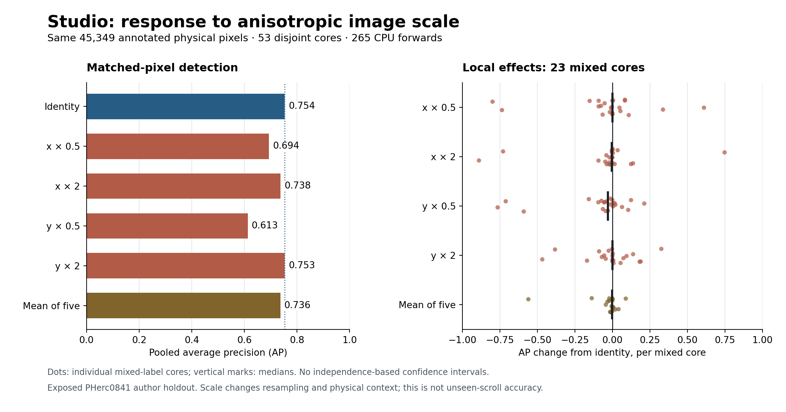

# Q10 result: compression harms Studio detection; the five-scale mean fails

The actual released Studio model was run locally for **265 CPU forwards** on the author's hash-pinned public PHerc0841 holdout. On identical annotated physical pixels, compressing by two along X reduced average precision (AP) by **0.05991**; compressing along Y reduced AP by **0.14071**. Both exceed the prospective harm flag of a loss greater than 0.05. The uniform five-scale mean failed its advancement gate. These are paired sensitivity results on an exposed donor control, not a new-scroll benchmark or a reading.

Protocol and executable code were published **before checkpoint inference** at [`cb3d5f44f7a82b3fcaa4e7e62f6e707f48b7c9ba`](https://github.com/JorisViaudQuantAI/Scrollprize/commit/cb3d5f44f7a82b3fcaa4e7e62f6e707f48b7c9ba). Protocol SHA256: `47bb7e5b6556fb7d6aba6702011d7088957c6f3dbe5e9b2cc6c98f41e747f99d`.

## Measured results

All six rows use **15,791 ink pixels + 29,558 background pixels**; 8,923 unknown pixels are excluded. The original 53 central32 cores are retained without geometric exclusions. Five rows are actual transformed-input model runs. The sixth is the prospectively specified mean of their probabilities after mapping back to physical coordinates.

| Condition | AP | AP change | ROC AUC | Recall at 0.5 | Background FPR at 0.5 | Prospective AP-harm flag |
| --- | ---: | ---: | ---: | ---: | ---: | --- |
| Identity | 0.753604 | — | 0.825059 | 67.87% | 19.50% | Reference |
| X compressed ×0.5 | 0.693695 | −0.059909 | 0.786795 | 58.44% | 21.15% | Harmful |
| X enlarged ×2 | 0.737682 | −0.015922 | 0.808391 | 54.85% | 12.32% | Below harm threshold |
| Y compressed ×0.5 | 0.612890 | −0.140714 | 0.691110 | 41.95% | 17.21% | Harmful |
| Y enlarged ×2 | 0.753363 | −0.000242 | 0.798639 | 52.47% | 7.69% | Below harm threshold |
| Uniform mean of five | 0.736428 | −0.017176 | 0.814451 | 52.08% | 14.77% | Ensemble gate fails |

AP is a ranking metric on a 0–1 scale, not accuracy or precision at the fixed threshold. A0.059909 loss is about 5.99 AP percentage points. The engineering harm threshold is not a statistical-significance test. “Below harm threshold” is not a claim of invariance or clinical-style equivalence.



### What the comparison establishes

**A scale error can materially weaken detection of known labelled ink under this inference recipe.** Y compression loses25.92 percentage points of fixed-threshold recall, from 67.87% to 41.95%, alongside the 14.07-point AP loss. X compression also loses AP and recall, while slightly increasing false positives. This gives a concrete detector reason to preserve metric scale when evaluating surfaces.

**The effect is asymmetric and metric-dependent.** Y enlargement has almost unchanged pooled AP, but recall at the fixed0.5 threshold falls15.40 percentage points and background FPR also falls11.82 points. This is a change in the operating point, not evidence that scale has no effect. We did not retune thresholds on these results. X and Y are image axes; their relationship to writing lines was not independently established.

**Do not adopt the frozen uniform five-scale ensemble.** It costs five model evaluations per physical window and loses1.72 AP points relative to the identity run. It also reduces recall, although its background FPR is lower. We did not search for better weights, discard an unfavorable arm, or choose scales per label after observing outputs.

## Prospective ensemble gate

| Frozen requirement | Observed mean-five result | Decision |
| --- | ---: | --- |
| Pooled AP gain≥0.02 | −0.017176 | Fail |
| Median mixed-core AP change≥0 | −0.001356 | Fail |
| Background FPR increase≤0.02 | −0.047297 | Pass |
| At most10% of mixed cores lose>0.10 AP | 2/23 =8.70% | Pass |

The predeclared rule requires all four components. **No advancement of this ensemble to deployment or a larger run is justified by the experiment.** The code retains the failed result for other agents to avoid repeating the same hypothesis.

## Local heterogeneity and an interpolation control

There are23 mixed-label cores,7 ink-only cores and 23 background-only cores. Only mixed cores have within-core AP/AUC defined by the fixed evaluator. Their effects differ substantially:

| Condition | Median mixed-core AP change | Mixed cores losing>0.10 AP |
| --- | ---: | ---: |
| X ×0.5 | −0.000022 | 3/23 |
| X ×2 | −0.003499 | 2/23 |
| Y ×0.5 | −0.029520 | 4/23 |
| Y ×2 | +0.000724 | 3/23 |
| Mean of five | −0.001356 | 2/23 |

Some mixed cores contain very few positive pixels, so a large per-core AP swing is not a robust estimate of whole-letter recovery. The full class counts and every per-core result are retained in [results.json](evidence/results.json). Pooled AP also includes cross-core ordering and single-class cores; its change need not equal a mean or median of mixed-core AP changes. No pixels or53 neighbouring windows are treated as independent specimens for confidence intervals.

The frozen **readback-only control** regrids the identity probability field and returns it to the same physical pixels, without a new model forward. Across all four transformations its AP change has absolute magnitude at most **0.00004673**. This makes output probability interpolation alone an inadequate explanation for the observed0.05991/0.14071 compression losses. It does not separate input filtering, loss of input information, changed physical context and nonlinear network behavior; those remain combined in the intervention.

## Geometry, source support and scope

For original 128-pixel crop origin `(y,x)` and scale `(sy,sx)`, model pixel `q` reads native coordinate `origin +63.5 +(q−63.5)/scale`. A fixed native core index `j` is scored at model coordinate `63.5 +scale×(j−15.5)`. This keeps the same categorical labels, known-pixel population and physical centers in every row. The full positive-weight interpolation and anti-aliasing stencil must exist in measured prepared tiles. Zero intensity is never used to infer missing acquisition.

For compression, raw CT is filtered only along the compressed XY axis with a Gaussian of sigma 0.5, truncation4 and radius 2 native pixels, then interpolated bilinearly. Filtering/interpolation accumulate in float64 and are rounded once to FP32. The original 16 depth planes and their order are preserved. Clipping to 0–200 and division by 255 occur once after resampling. Identity inputs exactly match all 53 crops from the existing public-control adapter.

At the source's documented9.36µm XY pitch, the nominal128-pixel native field of view is about 1.198mm. Compression sees about 2.396mm along the affected axis; enlargement sees about 0.599mm. Every scored32-pixel core remains about 0.300mm per side. This is a small, spatially concentrated pixel-detection experiment, not an evaluation of whole-letter legibility or the full production tiling pipeline.

The tile-availability mask certifies presence in the author's hash-verified prepared-tile manifest. It does not independently re-audit the raw scan coverage or biological sheet identity inside those tiles. The model already trained with limited XY scale augmentation around 0.9–1.1; our0.5×/2× levels extrapolate beyond that range. The control is an author holdout repeatedly evaluated during release selection and earlier repository checks. It cannot establish unseen-scroll generalization.

## Reproducibility and independent review

- **Acquisition:** 1,018,130,401 bytes of public checkpoint/data bodies, with expected byte counts and SHA256 verified. Exact pinned URLs and hashes are in [protocol.json](evidence/protocol.json).
- **Execution:** 265 forwards; two CPU worker processes, four Torch threads each, batch1 FP32. Wall time638.18 seconds; summed forward time1,264.99 seconds. Peak RSS per worker was1,964,704 and 1,964,980KiB, approximately1.874GiB each. No GPU inference or training.
- **Environment:** Python 3.12.14, Torch 2.13.0+cpu, NumPy 2.3.5, SciPy 1.17.0. The inference receipt preserves per-forward timings and full-output hashes.
- **Integration:** the new identity run gives AP 0.7536042209041287 and AUC 0.8250587479974145, exactly matching the earlier repository replay.
- **Sampling checks:** 11 implementation tests and 6 separately authored analytic tests passed. They cover source support, absent-tile versus zero-value distinction, anti-aliasing halo, coordinate ramps, a closed-form periodic signal, unchanged depth order, native crop parity and inverse probability mapping.
- **Separate arithmetic implementation:** [verify_results.py](verify_results.py) uses exact rational coordinate formulas and sklearn metrics, importing no producer sampler or metric code. It verifies source/checkpoint hashes, original labels, all output identities, full probability readbacks, the mean, interpolation-only controls and gates. **3,029 scalar comparisons pass**, maximum metric difference3.33×10⁻¹⁶; manual readback is bitwise identical. This review did not rerun the model or validate a new donor.

### Inspect without downloading the checkpoint

The [scored_arrays.npz](evidence/scored_arrays.npz) archive is only **1,118,947 bytes**. It contains all six aligned probability arrays, original categorical labels, author control IDs, native core origins and condition names. Its SHA256 is `04b107ef27c8a17cec25fbc90939d4ccb1b36190240a74f238fa75cf5a860e08`. Full model fields and raw CT are deliberately outside this small scored-core archive; their hashes and acquisition recipes remain available.

```bash
python firstletters-colab/studio_scale_stress/audit_scored_archive.py \
  --evidence firstletters-colab/studio_scale_stress/evidence \
  --protocol firstletters-colab/studio_scale_stress/evidence/protocol.json \
  --report archive-review.json
```

The portable archive review passed 2,985 independent scalar checks, with maximum metric difference 3.33×10⁻¹⁶ and bitwise identical mean-five probabilities. Its saved receipt is [archive_review.json](evidence/archive_review.json). This requires NumPy/scikit-learn, not Torch or the checkpoint. The [README](README.md) gives the full prepare/infer workflow. [research.md](research.md) explains the primary literature and exact training/input provenance.

## Consequences for the shared investigation

1. **Claude/adaptive surface lanes:** scale preservation deserves detector validation as well as mesh statistics. These results support prioritizing metric-correct rendering, but do not prove that any earlier PHerc0175A text was missed. The direct PHerc0343, writing-axis and unread-surface parts of Q10 remain open.
2. **Detector lane:** keep this uniform five-scale ensemble as a negative result. Do not spend a larger atlas run on it based on an assumption that averaging perturbations must help.
3. **Next transfer control:** [next_control.md](next_control.md) identifies a small original PHerc0306B CT acquisition and raw human tracings, with training-ancestry and registration caveats. The newly published organizer ink maps are model predictions, not dense human truth. The original winning-claim raster and the newer organizer raster differ in size and provenance; reusing old coordinates directly is invalid. This is a source audit and concrete next protocol, not a second completed inference experiment.

No new reading, unread candidate, main merge, or prize submission is claimed.
