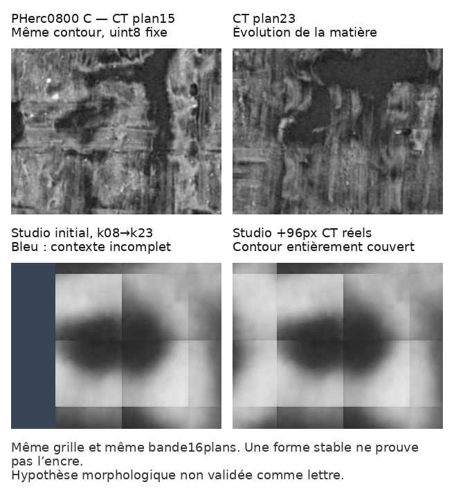
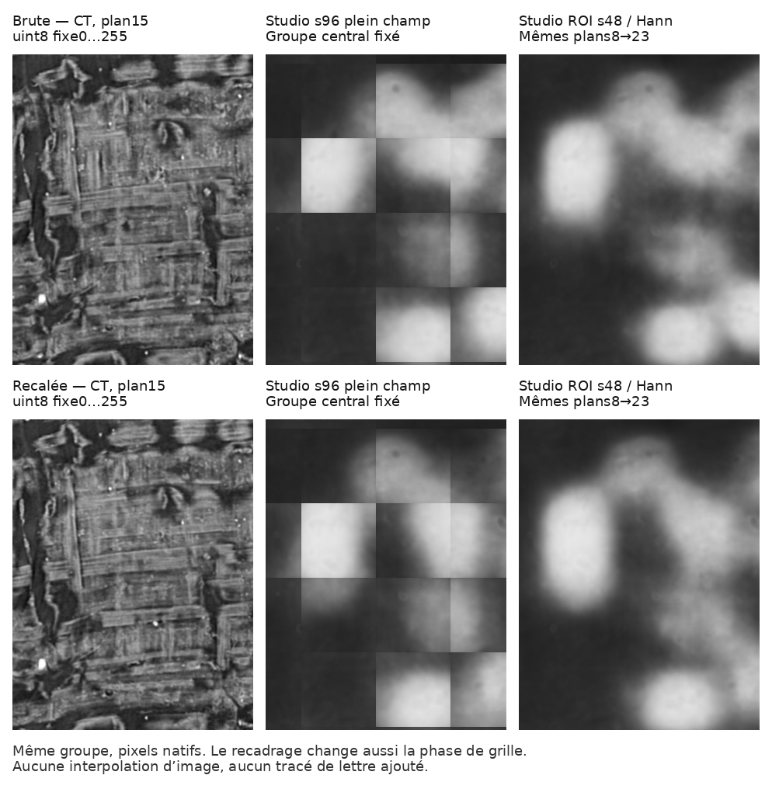

# Campagne visuelle du 24 novembre 2026

**Aucune nouvelle lettre ni séquence de texte validée.** Cette contribution publie une piste morphologique précise sur PHerc0800, une comparaison de rendu sur PHerc0125 et les contrôles qui permettent de décider quelles vérifications poursuivre. Les observations nouvelles ont été explicitement autorisées à la publication par l’utilisateur. Leur statut reste exploratoire.

Les principaux résultats sont consultables dans le [rapport complet](REPORT.md), les [sept figures](figures/) et les [lectures séparées figées](reviews/). Le paquet compact pèse moins de 10 MB. Il comprend les valeurs nécessaires pour recalculer les métriques ci-dessous, sans charger un modèle.

Les observations proviennent de l’agent principal et de sous-agents ayant séparé puis figé leurs lectures avant comparaison. Elles ne constituent pas une validation paléographique humaine.

## Vérification rapide, sans GPU

Depuis la racine du dépôt, avec **Python 3.9 ou ultérieur et NumPy** :

```bash
python3 firstletters-colab/visual_discovery_20261124/verify_evidence.py
```

La sortie JSON doit indiquer `verified_saved_evidence`, `new_model_forwards: 0` et les comptes du tableau ci-dessous. Le script n’utilise pas le réseau. Si NumPy n’est pas installé, l’ajouter à l’environnement Python utilisé avec `python3 -m pip install numpy`.

Cette commande contrôle les empreintes des fichiers publics puis recalcule les métriques à partir des probabilités, masques, scores annotés et profils enregistrés. Elle ne retélécharge pas le CT et ne réexécute pas l’inférence historique. Une valeur recalculée à partir de sorties conservées n’est pas une nouvelle observation indépendante.

## Résultats et portée

| Travail | Résultat vérifié | Ce qu’il permet de conclure |
|---|---|---|
| Comptabilité de la campagne | 13 cartes, 1 078 fenêtres de prédiction et 13 sentinelles d’identité réussies : **1 091 forwards** | Exécution historique documentée. Deux cartes sont des contrôles connus, onze des sorties exploratoires. Les 18 cartes publiques inspectées ne sont pas recomptées. |
| PHerc0800 C, extension de contexte réel | Boîte fixe de 72 960 pixels désormais à contexte complet ; 57 600 sorties déjà valides identiques bit à bit ; **15 360 pixels nouvellement admissibles** | Le contour fermé persiste après remplacement du contexte réfléchi à gauche. Une **silhouette de type O faible** reste possible ; aucun glyphe robuste ni mot. |
| PHerc0125, groupe central | Sur les mêmes 2 750 paires aux anciens raccords : saut moyen **34,0367 → 1,0785** en géométrie brute ; **33,8182 → 1,0116** après recalage, en niveaux/255 | Le rendu devient plus continu. Aucun glyphe n’est identifié. Cadrage, phase, pas et mélange ont changé ensemble. |
| PHerc0800 C, repère CT natif | **7 744 / 7 776 valeurs exactement égales** ; les 32 autres diffèrent de ±1 niveau uint8 | Forte compatibilité de la recette géométrique historique aux six petites zones testées ; aucune conclusion globale sur l’anatomie ni sur le texte. |
| PHerc0841, contrôle public connu | 67 113 pixels d’encre et 111 310 de fond, tous à contexte complet ; **AUC 0,833212667**, **AP 0,788154413** | Diagnostic de restitution sur annotations déjà connues. Les 608 009 pixels inconnus sont exclus ; aucune validation indépendante de généralisation. |

Les chiffres sont recalculés par [verify_evidence.py](verify_evidence.py). Les [reçus de campagne](receipts/campaign_summary.json) identifient les sorties historiques et les deux versions du wrapper qui les ont produites. Les métriques des autres conventions géométriques sont également recalculées à partir des profils conservés.

## Images à examiner

### PHerc0800 : contexte ajouté sur une hypothèse fixée



Le rectangle global est **x932:1236, y826:1066**, sur le segment `20251028220955-auto_grown_20251028220955262`. La nouvelle entrée ajoute exactement 96 pixels à gauche et conserve la phase s96. Le changement moyen de probabilité sur la bande nouvellement admissible est 0,042615924 ; le maximum est 0,180886030. Ces valeurs mesurent la sensibilité au contexte, sans estimer l’authenticité d’une lettre.

La [fiche candidate](candidate.json) porte `unconfirmed_morphological_hypothesis`, `novel_text_claim: false` et `ground_truth_eligible: false`. Le contour était déjà visible dans certaines cartes publiques. L’apport de cette campagne est sa sélection, les nouveaux calculs locaux et les contrôles ; la silhouette n’est pas revendiquée comme une découverte initiale.

Voir aussi les [seize profondeurs CT](figures/0800_all_depths.png), la [comparaison CT/modèles](figures/0800_ct_models.png) et la [lecture finale du contexte](reviews/pherc0800_C_context96_round2_comparison_frozen.md). L’explication concurrente par des frontières matérielles et des fibres demeure ouverte.

### PHerc0125 : correction du rendu sur le même groupe



Le groupe global **x530:840, y180:580** contient 124 000 pixels, tous à contexte complet dans les quatre sorties comparées. Le maillage est `z14144_w025`. Le nouvel input de 608 × 512 pixels provient d’une copie exacte de la fenêtre **y80:688, x432:944**, puis d’une inférence à pas 48 avec Hann.

Le montant et certaines branches persistent, mais leurs connexions restent sensibles à la géométrie. Les [quatre cartes initiales](figures/0125_four_maps.png) et la [lecture figée après raffinement](reviews/pherc0125_s48_round2_comparison_frozen.md) documentent cette limite. Le résultat motive une amélioration du rendu, sans transformer la continuité visuelle en preuve d’écriture.

### Contrôle connu et repère natif

La [planche PHerc0841](figures/0841_known_control.png) montre les limites de restitution sur des formes déjà annotées : certains traits sont retrouvés, d’autres restent fragmentaires. Une sortie peu lisible sur un nouveau papyrus ne suffit donc pas à déclarer cette région dépourvue d’encre.

La [figure des profils natifs](figures/0800_native_profiles.png) illustre une vérification différente : l’accord numérique entre échantillons de CT et valeurs du volume de surface. Le [CSV de 7 776 valeurs](data/sample_values.csv) permet de recalculer les égalités, la troncature et les écarts signés. Les valeurs natives interpolées sont conservées ; le paquet compact ne contient pas les sept chunks CT nécessaires à un nouveau replay géométrique.

## Utilisation dans une chaîne de triage

Ces observations justifient quatre règles opérationnelles :

1. **Conserver trois états de validité distincts** : sortie du modèle, disponibilité des plans source et contexte complet. Un défaut de contexte appelle une reprise du rendu avant une décision de lecture.
2. **Dédupliquer les mêmes calculs à partir de leur provenance.** Les deux cadrages C se recouvrent, les ordres sont inversés sur la même bande, et les géométries raw/snapped restent liées. Leur concordance n’est pas une collection de découvertes indépendantes.
3. **Traiter les raccords comme un défaut de restitution mesurable.** Comparer les mêmes pixels après un raffinement ; consigner le cadrage et la phase pour ne pas attribuer tout changement au seul mélange.
4. **Conserver une catégorie “non concluant”.** Une réponse faible, une silhouette ambiguë ou l’absence de lettre lisible peut modifier la priorité du prochain calcul. Ces sorties ne justifient pas à elles seules l’exclusion définitive d’un papyrus ni des étiquettes négatives d’encre.

Le candidat C reste un cas de revue. Son prochain contrôle discriminant est le suivi anatomique d’une même feuille, avec davantage de contexte de ligne et un rendu continu, en conservant le rectangle et l’hypothèse actuels. Il ne doit pas alimenter un jeu d’entraînement comme lettre confirmée.

## Organisation et provenance

| Élément | Usage |
|---|---|
| [REPORT.md](REPORT.md) | Rapport scientifique de la campagne, adapté pour cette diffusion compacte. |
| [PROVENANCE.md](PROVENANCE.md) | Sources épinglées, limites du paquet, transformation des reçus et portée des empreintes. |
| [manifest.json](manifest.json) | SHA-256 des fichiers publics et SHA-256 des originaux conservés séparément. |
| [data/](data/) | Crops float32 exacts, masques bool, scores/étiquettes connus, CSV et profils du replay. |
| [metrics/](metrics/) | Mesures historiques comparées aux recalculs. |
| [receipts/](receipts/) | Treize reçus d’inférence, planification, sources et acquisition. |
| [reviews/](reviews/) | Lectures séparées figées ; leurs mentions historiques de dossier privé sont conservées. |
| [build_evidence.py](build_evidence.py) | Extraction reproductible depuis le dossier original complet, fourni séparément par son détenteur. |

Les grands volumes d’entrée, cartes complètes, poids du modèle et atlas HTML sont exclus pour limiter cette contribution à moins de 10 MB. Les reçus signalent les fichiers historiques absents ; leurs identifiants `artifact://…` ne sont pas des liens de téléchargement. La vérification publique couvre précisément les données présentes.
