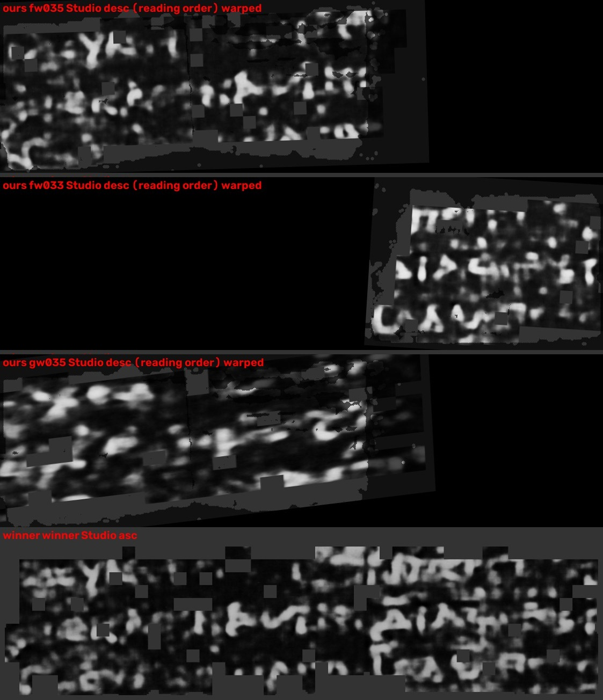
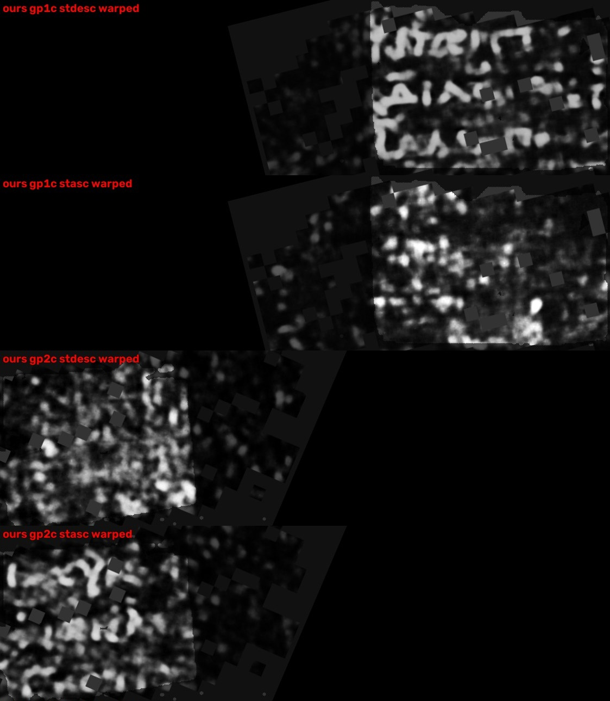

# From a CT volume to legible letters with no hand-made surface: a calibrated recipe, the tools to run it on small GPUs, and the surfaces and maps to check it

Progress Prize submission, November 2026. One owner directing four AI coding agents (Claude Code, Gemini,
ChatGPT, Codex). Everything is in this repository, branch `claude/firstletters-colab`.

This entry is separate from the owner's two earlier November entries (flat-ROI occupancy reads; the First
Letters Colab toolkit of 21 November). Nothing here repeats them.

## 1. The result on real data

**Our own automatic spiral fit of PHerc. 0211 shows the awarded letters.** No use of the winner's mesh, no
manual refinement: villa's spiral fitter, flatboi, and the released Studio detector.



- Rows 1–2: two neighbouring windings of our fit after per-surface flattening. The winding that lies on the
  letter sheet shows the three rows, with ΔΙΑ in the awarded row at the same place as on the winner's map (bottom).
- Row 3: the same fit **without flattening**. Nothing is legible.
- Line-finder score in the reading order: 8.57 on our winding, 8.94 on the winner's mesh, 4.4–4.9 in the other
  order, 5.3–6.0 on the unflattened grid.

A local surface regrown from a point that a blind review had only noted as "a look" gives the clearest map:



The review was blind: 60 windings were read and judged before the winner's location was opened.

## 2. What we learned that others can use now

| finding | number | where |
|---|---|---|
| A fit grid rendered as it comes is sheared and stretched at letter scale | shear −26°/+27° (5th/95th percentile), stretch 0.6–3.1× along the turn; the winner's mesh: ±1.7°, 0.98–1.02 | `firstletters-colab/results/pherc0211_calibration/tables/` |
| Per-winding flattening removes it, in seconds | flatboi: −4.5°/+2.8°, 0.95–1.04, 2–4 s per winding. Pure-CPU 2D ARAP (NumPy/SciPy, Windows and Linux): median 6.0° at the 95th percentile, 6.7 s per winding | `results/pherc0211_calibration/code/flat_set.sh`, `gemini_lane/arap_flatten_tifxyz.py` |
| Detectors are sensitive to in-plane scale and tilt | Studio on PHerc. 0841: 2× compression costs 6 and 14 AP points along the two axes; A-hn on PHerc. 0306B: 2× enlargement drops recall at 0.5 from 0.33 to 0.07 | `firstletters-colab/studio_scale_stress/`, `studio_oblique_stress/` |
| Stride 96 without blending ranks; stride 48 with Hann reads | letter windings 6.9–7.0 against 2.4 in the other order and 2.6–3.7 on controls; letters only faint at stride 96 | `results/pherc0211_calibration/REPORT.md` |
| The reading order follows the side the normal points to, and fitted windings can have it reversed and the text mirrored | normals of our fit point away from the umbilicus, the winner's towards it | `results/pherc0211_calibration/code/normside.py` |
| The spiral fitter's on-sheet check cannot tell the winding sense | PHerc. 0175A fitted in the wrong sense: 0.265 of vertices on a sheet against 0.203 for the control; right sense 0.269 against 0.201 | `results/wrong_sense_control_0175A/` |
| A public atlas of fitted windings holds one winding in 20 | the PHerc. 0211 letters lie at least 46 voxels from any of its 90 meshes | `results/hindsight_0211/` |
| Legible windows are sparse even on a scroll that reads | 3 of 149 windows of flattened windings and 1 of 12 GrowPatch windows judged as showing letters; all in the top 5 % by the stride-96 line finder | `REPORT.md`, section "Task P" |

## 3. Tools

**Unwrapping**
- `results/pherc0211_calibration/code/` and `jobs/`: a chunked, resumable runner for villa `fit_spiral.py` at
  `0fb38c45` (`patch_fitter.py`, `patch_deadline.py`, `run_chunk.sh`): one 30,000-step schedule in 35-minute
  chunks on a 24 GB GPU that can be pre-empted; 5.6–8 GPU-hours per band of 1,500 slices.
- Fits for scrolls with missing inputs: our own track extraction with the published parameters (validated
  against published tracks: identical horizontal tracks, vertical within 4 %), normals synthesised from the
  surface prediction, a hand-placed umbilicus (`results/spiral_fits/`).
- `gridq.py`: shear, stretch and roughness of any `tifxyz` as it will be rendered. `flat_set.sh`: flatboi over
  a set of windings. `gemini_lane/arap_flatten_tifxyz.py`: the same step with no compiled dependency.
- `gemini_lane/spiral_winding_resample.py`, `grow_m7_patch.py`, `seismic_rgt_unwrapper.py`: a quasi-isometric
  resampler, a patch grower that streams the surface prediction under a 100 MB budget, and a multi-sheet
  relative-geologic-time unwrapper tested on small public crops.

**Ink detection on small GPUs**
- `firstletters-colab/studio_t4/` and `gemini_lane/progress_prize_fp16/`: fp16 for Studio and Hecate. On a T4,
  Studio's peak memory at batch 1 falls from 11.35 GB to 1.17 GB; Hecate runs 3.0× faster with a maximum
  difference of one grey level. On an 8 GB RTX 4060, fp16 stays within 0.003 of fp32. Patches for both upstream
  repositories are ready (`0001-…`, `0002-…`).
- `gemini_lane/stream_snap_render.py`: renders a surface stack straight from the bucket with nothing kept on
  disk. A Zarr stencil reader halves the CT bytes read (370 to 180 MiB on one PHerc. 0846B render).
- `firstletters-colab/onsheet_score/`: a layer-coherence score that says whether a rendered stack lies along a
  sheet, with the table for 250 public windings.

## 4. Data released

- PHerc. 0211: the 120 fitted windings, the 60 flattened ones, four windings with per-vertex distance to the
  winner's mesh (`firstletters-colab/pherc0211_fit_windings/`), and benchmark maps for the whole band: Studio at
  stride 96 for 60 windings, stride 48 for 40 windows, masks and recipe
  (`results/pherc0211_calibration/maps_export211/`).
- PHerc. 0175A and PHerc. 1203: 120 fitted windings each, from 30,000-step fits, with gates and job scripts.
- Anatomy statistics per height band for 19 eligible and 7 read scrolls (`industrial_funnel/S0_priors_by_zband.csv`).
- A ledger of every method tried, with its numbers and the script that produced them
  (`firstletters-colab/methods_ledger/`, 52 entries).

## 5. How to reproduce the headline result

```bash
# on a 24 GB GPU; paths as in results/pherc0211_calibration/
bash jobs/wl_201_acw_c01.sh        # … to c10: the fit, 30,000 steps
bash code/flat_set.sh              # flatboi per winding, quality table
bash jobs/mk_read.sh               # render 41 layers, Studio stride 96, rank, stride 48 on the top
python code/place.py --win <winner tifxyz> --mesh <our flattened winding> …   # the figure above
```

The lines above are a sketch. The exact job chain, settings and code versions are in the section "RECIPE" of the
working report (`results/pherc0211_calibration/REPORT.md`), which logs every job, including the ones that failed.

## 6. Limits, stated plainly

- No new reading on an unread scroll. Our screens of unread scrolls with this recipe have found nothing so far.
- The letters appear only where a winding stays on the letter sheet, about a third of the awarded area. In
  crushed zones both the fit and GrowPatch step to a neighbouring sheet.
- The hit rates come from one scroll and one band, chosen because text was known there.
- On PHerc. 0211, reader-v3 through our path showed two chevrons where Studio showed the rows. This is not our
  reader path: on the PHerc. 0846B winner's segment the same path reproduces the winner's map (r = 0.91–0.94
  against the published map, the same letters legible; `collab/claude-032.md`).
- The multi-sheet unwrapper has only been run on crops of a fraction of a square centimetre.

## 7. Who did what

Claude Code: spiral fits, the PHerc. 0211 calibration, flattening quality, rankers, the wrong-sense control, the
ledger. Gemini: the ARAP flattener, the streaming renderer, the fp16 patch kit and its parity runs on an RTX 4060,
the resampler and patch grower, large screens on consumer hardware. ChatGPT: the scale, shear and tilt stress
tests of the detectors, independent replays of our tables, the Zarr reader. Codex: registration between scans
and public controls.
